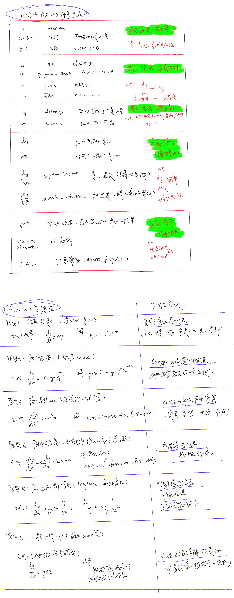

## 动力系统常用数学符号和六种动力学原型（公式+解）

```
先用这几类常见结构理解动力系统；具体问题仍要检查变量、量纲和模型假设。
```

> **原手绘图修订说明（2026-11-04）：保留原图作为学习记录，适用条件以本说明及下文为准。**
>
> - 图中“原型 4”的正弦/余弦乘指数包络解，仅适用于质量已归一化、`c,k>0` 且 `c²<4k` 的欠阻尼自由响应。此时 `α=c/2`、`ω=√(k-c²/4)`；临界阻尼和过阻尼不作周期性往返振荡。持续受外力驱动还需在方程右侧加入驱动项。
> - 图中“原型 5”的 Logistic 方程，在 `r,K>0`、`0<y(0)<K/2` 时，总量的绝对增速先增后减，在 `y=K/2` 最大；随总量增加而持续降低的是相对增速 `y'/y`，不是始终降低的绝对增速。

  

---

直观的例子：

### 指数原型

`dy/dt = k y`

> 越多越快，越少越慢；变化完全取决于当前量。

eg

- 钱的利息（复利）
- 信用卡欠款增长
- 人口增长（不考虑资源）
- 放射性衰变（越多衰得越快）
- 电容放电初期（RC 电路）
- 咖啡浓度稀释（连续稀释）
- 小区里某个流言越来越多人知道
- 手机电量掉得快（满电时掉电更快）
- 病毒传播的早期阶段
- 水果烂掉后变烂速度越来越快（微生物指数繁殖）

⸻

### 稳态回拉（趋向某个固定值）

`dy/dt = -k (y - y*)`

> 系统被拉回到某个固定值，不会无限增长或减少。

eg

- 咖啡放着会变成室温
- 热水逐渐变成室温
- 冰块逐渐升温到 0°C
- 空调开着会把温度拉到设定温度
- 你用力搅拌杯子，水面 eventually 会变平静
- 人的体温恢复到 37°C
- 经济价格回到“均衡价格”
- 一堆衣服被烘干后逐渐接近空气湿度
- 高楼在风中轻微摇摆后逐渐稳定
- WiFi AGC（自动增益控制）把信号调回稳定大小

⸻

### 无阻尼振荡（完全来回、永不衰减）

`d²x/dt² = -ω² x`

像弹簧：来回震荡、永不消失（理想化）。

eg

- 理想弹簧来回振动（现实中会有阻尼）
- 完全无摩擦的冰面摆动
- 理想单摆（小振幅）
- 理想 LC 电子振荡（无线电载波本质）
- 声波在理论模型中的传播
- 完美的钟摆（假设没有空气阻力）
- 完美的弦振动（理论中的吉他弦）

现实世界几乎没有纯无阻尼的，但它是基本原型。

⸻

### 线性自由阻尼系统（欠阻尼时为衰减振荡）

`d²x/dt² + c dx/dt + kx = 0`

这里质量已归一化为 1，`c>0` 是阻尼系数，`k>0` 是恢复力系数，且没有持续外部驱动。

> 欠阻尼 `c²<4k`：来回振荡，振幅逐渐衰减；临界阻尼 `c²=4k` 和过阻尼 `c²>4k`：不作周期性往返振荡，趋向平衡。

欠阻尼时，图中的解写作 `x(t)=e^(-αt)[A cos(ωt)+B sin(ωt)]`，其中 `α=c/2`、`ω=√(k-c²/4)`。`A、B` 由初始位移和速度决定。

eg

- 秋千被推后，在不再施加推力时越荡越小（小振幅近似）
- 车的悬挂系统回弹（可能按临界阻尼附近设计，不一定来回弹）
- 压一下床垫会轻微弹几下就停
- 地震后建筑晃动几下就稳住
- 含电阻的 RLC 电路自由响应（参数决定是否振荡）
- 麦克风敲一下发出的“嘣”声
- 播放器低频扬声器的 cone 回落
- 船在水里摇晃后逐渐停

这些是可以借助该模型理解的自由响应；现实系统可能有非线性、多种振动模态或持续驱动，不能全部归入这个齐次方程。

参考：[OpenStax 的阻尼分类](https://openstax.org/books/university-physics-volume-1/pages/15-5-damped-oscillations)、[MIT 的欠阻尼、过阻尼与临界阻尼讲义](https://ocw.mit.edu/courses/18-03sc-differential-equations-fall-2011/7e212064ad281d00e1dac893b1f722a7_MIT18_03SCF11_s13_2text.pdf)。

⸻

### Logistic（自限性增长 / S 型曲线）

`dy/dt = r y(1 - y/K)`

这里 `r,K>0`，`y` 是总量，`K` 是承载上限。当 `0<y(0)<K/2` 时：

> 总量起初较少，绝对增速较小；随后加速，在 `y=K/2` 时增速最大，再减速趋于饱和，形成 S 型曲线。

相对增速 `y'/y=r(1-y/K)` 则随 `y` 增大而下降。若初值已经处于 `K/2` 与 `K` 之间，之后的绝对增速直接下降，不会再经历前面的加速阶段。

eg

- 一个微信群的累计人数（在增长机制近似满足模型时）
- 城市人口增长（受资源限制）
- 技术普及度（例如智能手机普及率）
- 新的社交媒体用户增长
- 一湖水里的鱼类数量增长
- 植物在有限土壤中的生长
- 一项技能的累计掌握程度（只是一种可能的近似，不能直接把“学习速度”当作 `y`）
- 新产品的累计采用量（需要数据支持相应增长机制）

以上是候选建模情景，不表示每个实际过程都服从 Logistic 方程。参考：[OpenStax 的 Logistic 方程与拐点推导](https://openstax.org/books/calculus-volume-2/pages/4-4-the-logistic-equation)、[MIT 的自主方程与相对增长率讲义](https://ocw.mit.edu/courses/18-03-differential-equations-spring-2010/8bb1f3122af8170cb6e480a7b4bdc889_MIT18_03S10_c08.pdf)。

⸻

### 相互作用原型（变化取决于两者相遇）

`dy/dt = β S I`

> 双方接触才能发生变化；不是单变量能控制的。

这里的乘积表达某种事件发生率，需要先定义 `S、I` 与系数 `β`，并满足相应的混合或接触假设，不能把任意两个数量相乘当成变化规律。

eg

- 传染病传播（需要感染者接触健康者）
- 双分子基元反应 `A+B→产物` 的反应速率 `v=k[A][B]`（在相应基元反应模型中，方括号表示浓度）
- 市场中买卖双方的接触机会（在均匀混合等假设下可用数量乘积近似，不等于实际交易量）
- 两人合作可以完成任务（单人不能）
- 打架双方互相伤害（攻击 × 暴露）
- 捕食者–猎物关系（狼吃羊）
- 需要两个物种才能繁殖的情况
- 社交场合中人气扩散（你必须与人互动）
- 两辆车在十字路口接触导致事故（概率 ∝ 流量 × 流量）

**更正：理发店的排队时间不等于“店员数 × 顾客数”。** 等待时间还取决于到达率、服务率、服务台数量与排队规则，应另用排队模型分析。这里用已限定条件的双分子基元反应代替原例；一般化学总反应也不能仅凭化学方程式认定速率正比于两种浓度的乘积。

参考：[MIT 的 M/M/1 排队模型讲义](https://ocw.mit.edu/courses/2-854-introduction-to-manufacturing-systems-fall-2016/927056a1af54772a587fd84ad4951e71_MIT2_854F16_Mm1Queue.pdf)、[OpenStax 的基元反应与速率定律](https://openstax.org/books/chemistry-2e/pages/12-6-reaction-mechanisms)。


