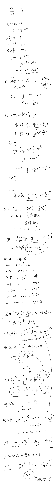
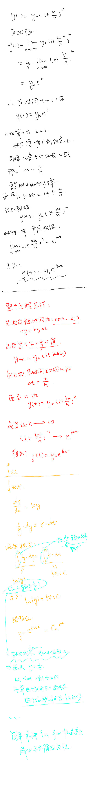

## 解dy/dt=ky

```
一种是假设我是个古人，我算极限的时候怎么逼近出这么个神奇的数值。  
另一种就是ln独立定义之后可以用现代的方法积分求出来。
```

- ln：logarithmus naturalis（拉丁语），自然对数。
- e：好像说是数学家Euler随便起的，说这个e还没被用过就用e吧。

> **手绘笔记勘误（2026-11-04）**：第一张图中，`n = 10000` 时 `(1 + 1/n)^n ≈ 2.7181459268`；约 `2.71828…` 是继续趋近的极限 e，不能提前填在这一行。这里想说明的仍是有限次复利逐渐逼近连续增长。对照 [OpenStax 的 e 与连续复利说明](https://openstax.org/books/precalculus-2e/pages/4-1-exponential-functions)和[Pearson 的极限定义](https://www.pearson.com/content/dam/one-dot-com/one-dot-com/us/en/higher-ed/en/products-services/course-products/sullivan-10e-info/pdf/Guided-Lecture-Notes-Sample.pdf)，并分别用高精度幂运算与对数形式复算。下方保留原图，该行数值以此为准。


  


