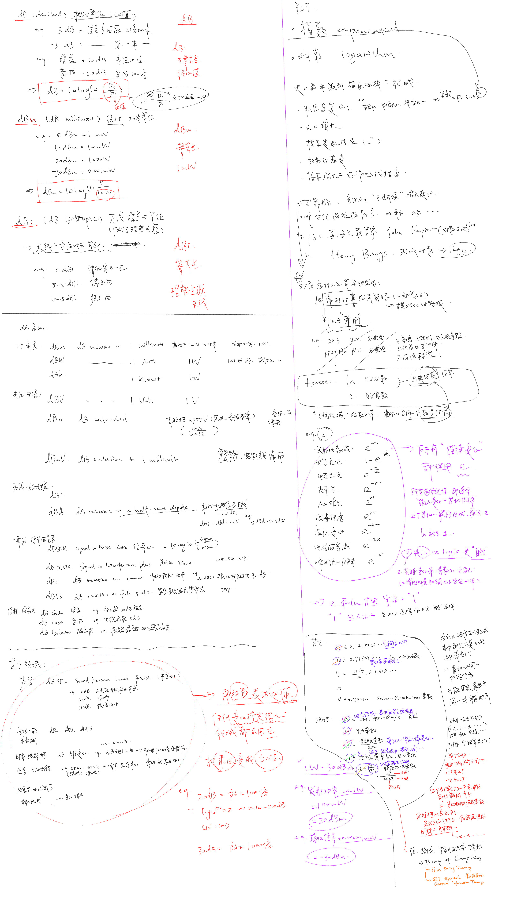

## dB、dBm和dBi，以及关于指数和对数

```
梳理一下常用的单位。
一些数学常识也可以顺带了解。
```

> **手绘笔记勘误（2026-11-04）**
>
> - 图中 dBmV 的英文说明应为“相对于 **1 millivolt（1 mV）**”，不是 1 milliwatt。电压电平为 `20 log10(V / 1 mV)`；dBm 才是以 1 mW 为参考的功率电平 `10 log10(P / 1 mW)`。电压换算成功率还需要负载阻抗，不能只换单位后缀。
> - 图下方接收功率若取 **−30 dBm**，应写 **0.001 mW = 1 µW**。`0.000001 mW` 对应的是 −60 dBm。发射功率 `0.1 W = 100 mW = 20 dBm` 的例子不变。
>
> 对照 [Keysight 的 dBm 与 Units 定义](https://helpfiles.keysight.com/csg/e5061b/whgdata/whlstg0.htm)及[Berkeley Nucleonics 仪器手册的 UNIT:POWer](https://www.berkeleynucleonics.com/docs/bnc-model-865b-user-manual.html)，并按公式重新计算。下方保留原始手绘记录，上述两处以此勘误为准。



