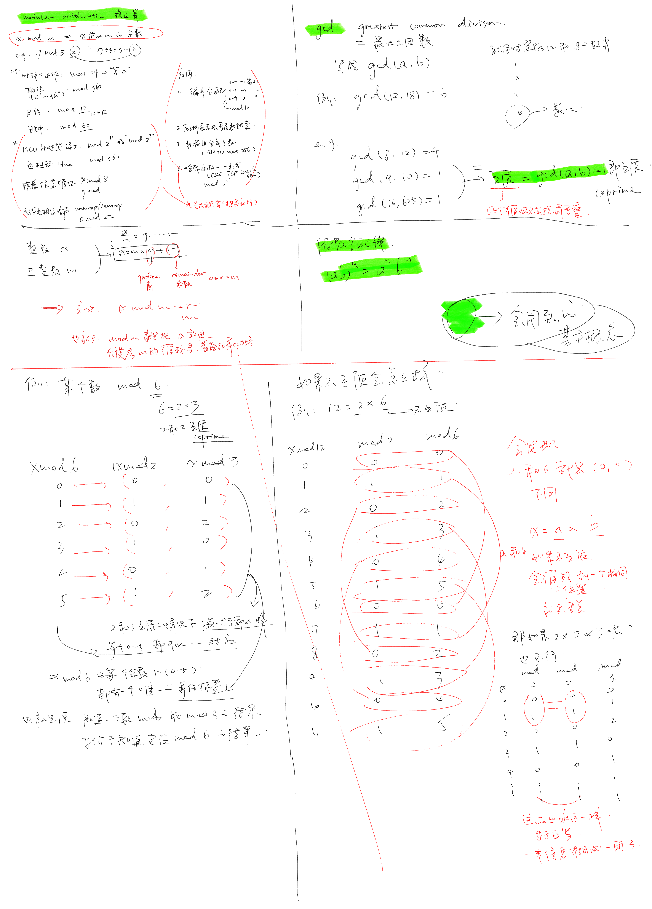

## 模运算：基本含义

```
贪多嚼不烂，先简单学点😁  
```

> **手绘笔记勘误（2026-11-04）**
>
> 图上方将 CRC、TCP checksum 一起写在普通整数 `mod 2^16` 旁，混在了一起。要说明整数回绕，可以用“16 位无符号整数加法按 `2^16` 取模”：`0xffff + 1` 回绕为 `0x0000`。
>
> - **TCP checksum** 用 16 位反码和，溢出的进位要加回低位，最后再按位取反。同样对两个 16 位字 `0xffff` 和 `0x0001` 求和，回卷进位后的和是 `0x0001`，最终校验值是 `0xfffe`；不是直接丢掉进位后取模。见 [RFC 1071](https://www.rfc-editor.org/rfc/rfc1071.html)和 [TCP 规范 RFC 9293 §3.1](https://www.rfc-editor.org/rfc/rfc9293.html#section-3.1)。
> - **CRC** 也有“取余”的结构，但对象是二元系数多项式：在 GF(2) 上做多项式除法，加减使用异或，不是把整个消息当普通整数去除以 `2^16`。具体还要按协议规定初始化、位序和最终处理。见 [RFC 4960 附录 B](https://www.rfc-editor.org/rfc/rfc4960.html#appendix-B)和 [RFC 1662 附录 C](https://www.rfc-editor.org/rfc/rfc1662.html#appendix-C)。
>
> 下方保留原始手绘记录，涉及这两种校验的例子以上述说明为准。




