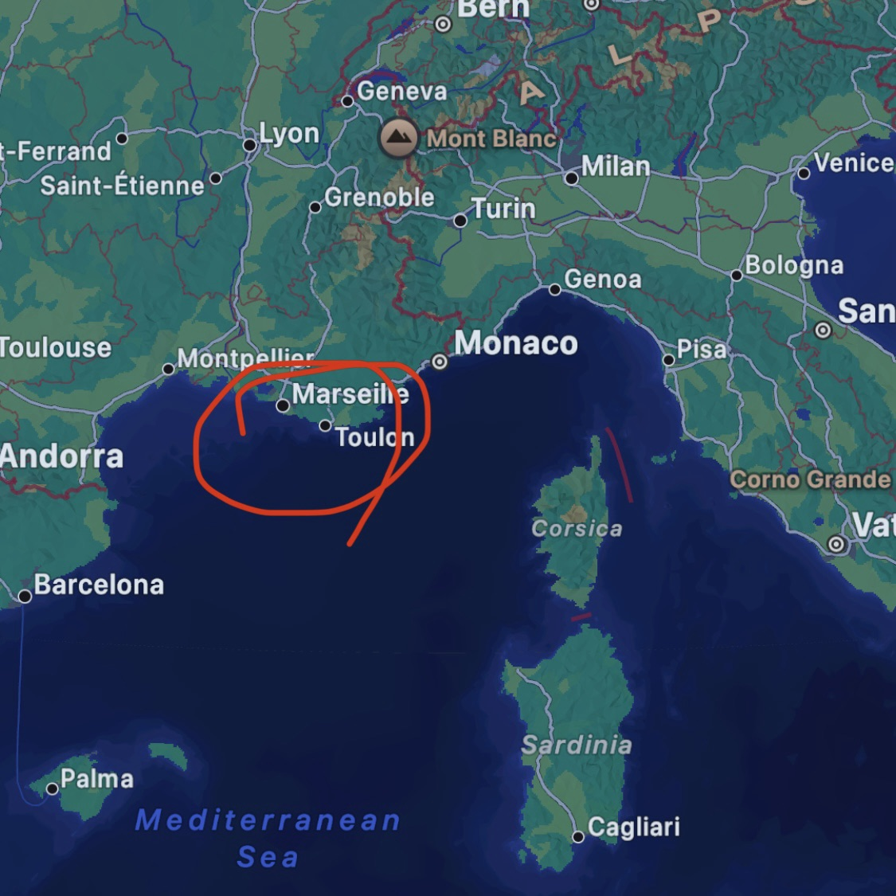
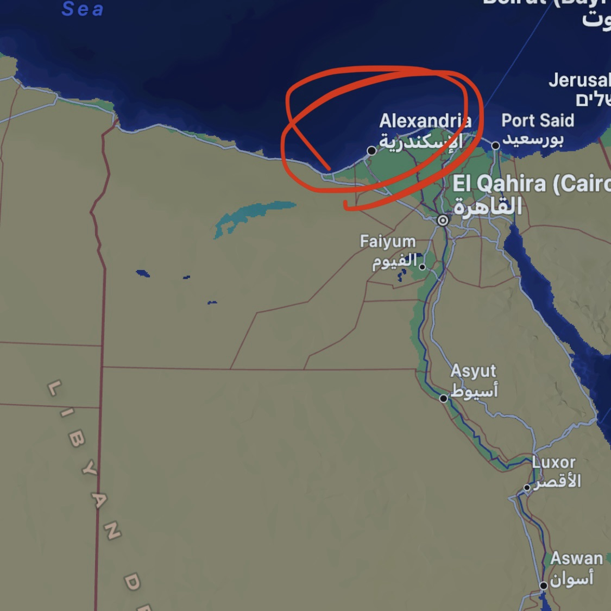
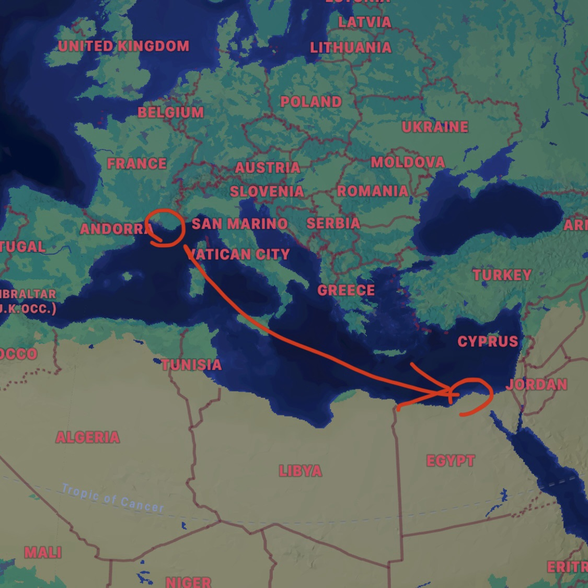



Poirot Goes to Egypt

<blockquote class="wp-block-quote is-style-default is-layout-flow wp-block-quote-is-layout-flow" style="font-size:13px;font-style:normal;font-weight:300;line-height:1.6">

“一个星期之后。在沙漠里，金色的沙子被我们踩在脚下，烈日直晒头顶。波洛神情痛苦，在我身旁萎靡不振。这位小个子男人可不擅长旅行。 我们从马赛坐了四天的轮船，对他来说真是种 漫长的煎熬。他在亚历山大登陆时已经不成人形了，甚至连他一贯的整洁也看不到了。我们一到开罗就立刻驱车前往米那宫酒店，就在金字塔附近。”

《埃及古墓历险记》

</blockquote>

<figure class="wp-block-gallery has-nested-images columns-2 is-cropped wp-block-gallery-1 is-layout-flex wp-block-gallery-is-layout-flex">
<figure class="wp-block-image size-large"><figcaption class="wp-element-caption"><a href="https://www.marseille.fr">马赛</a></figcaption></figure>
<figure class="wp-block-image size-large"><figcaption class="wp-element-caption"><a href="http://www.alexandria.gov.eg/default.aspx">亚历山大</a></figcaption></figure>
<figure class="wp-block-image size-large"></figure>
<figcaption class="blocks-gallery-caption wp-element-caption">Screenshot from Google Maps, captured on February 16, 2025</figcaption></figure>

<figure class="wp-block-table" style="font-size:13px;font-style:normal;font-weight:200"><table class="has-border-color has-contrast-border-color has-fixed-layout" style="border-width:1px"><thead><tr><th class="has-text-align-left" data-align="left">【Reference Deck】</th></tr></thead><tbody><tr><td class="has-text-align-left" data-align="left"><strong>相关作者</strong></td></tr><tr><td class="has-text-align-left" data-align="left">Agatha Christie（阿加莎·克里斯蒂）September 15, 1890 – January 12, 1976</td></tr><tr><td class="has-text-align-left" data-align="left"><strong>参考版本</strong></td></tr><tr><td class="has-text-align-left" data-align="left">阿加莎克里斯蒂. 首相绑架案[M]. 王占一, 译. 北京: 新星出版社, 2018. (原作出版于 1924 年) Christie, A. (1924). Poirot investigates. The Bodley Head.</td></tr><tr><td class="has-text-align-left" data-align="left"><strong>其他参考</strong></td></tr><tr><td class="has-text-align-left" data-align="left">Poirot, S5E1, “The Adventure of the Egyptian Tomb,” directed by Peter Barber-Fleming, written by Clive Exton, performance by David Suchet, aired January 17, 1993. Available on <a href="https://www.imdb.com/title/tt0676164/">IMDb</a>.（电视剧《大侦探波洛：埃及古墓历险记》第五季第一集）</td></tr></tbody></table></figure>


