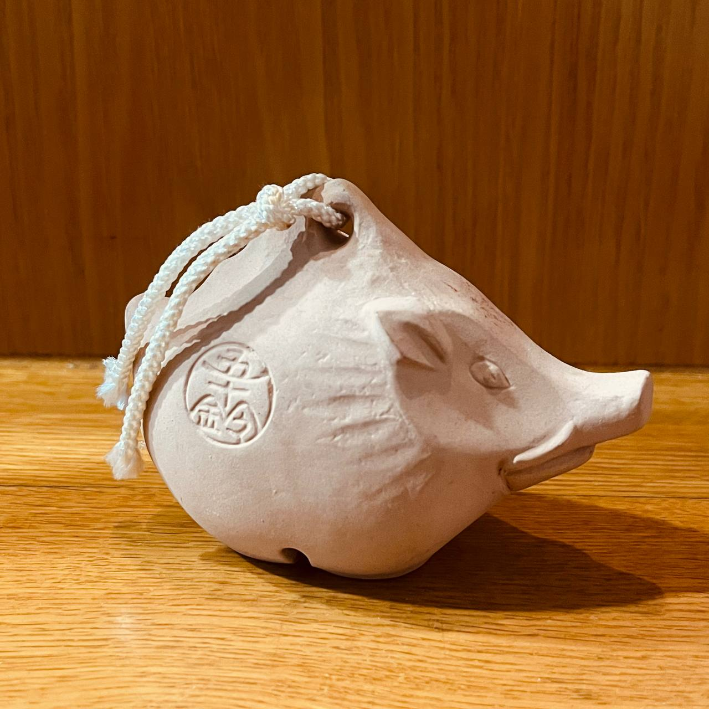
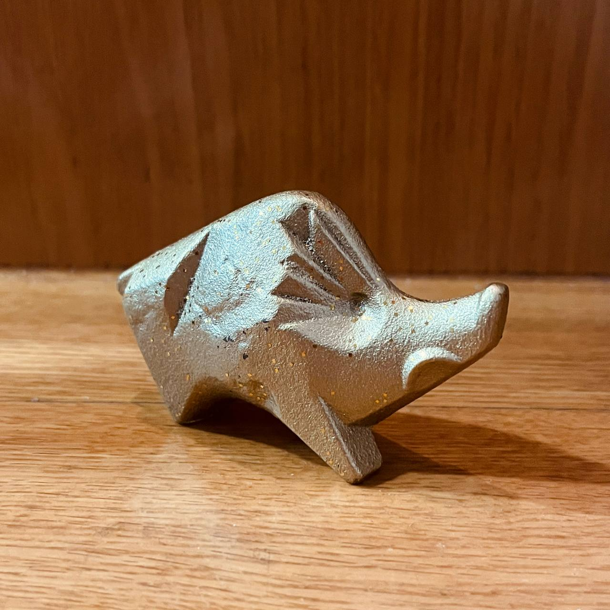
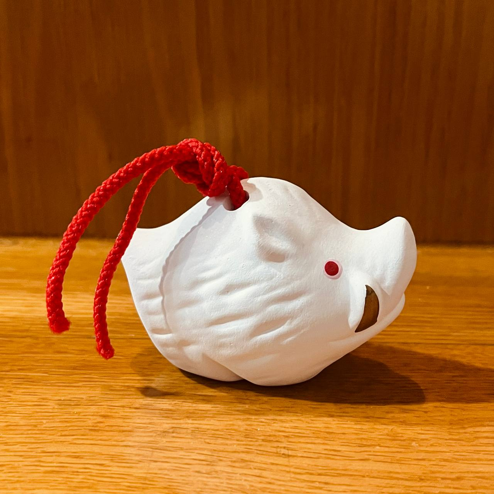



Schedule

<figure class="wp-block-image size-large"></figure>
<figure class="wp-block-image size-large"></figure>
<figure class="wp-block-image size-large"></figure>

近期的素材：

<ul class="wp-block-list" style="font-size:clamp(14px, 0.875rem + ((1vw - 3.2px) * 0.147), 15px);font-style:normal;font-weight:200;line-height:2">
<li>牛排腰子布丁（Steak and kidney pudding）</li>
<li>沙漠玫瑰（dessert rose cup）咖啡杯</li>
<li>猪猪</li>
<li>《笨拙》杂志（<em>Punch, or The London Charivari</em>）</li>
<li>英国的教区（Parish）</li>
<li>詹姆斯M凯恩的分析</li>
<li>嗅盐</li>
<li>鼻烟壶，烟斗，烟灰缸</li>
<li>形容不同的“笑”</li>
<li>钱德勒和奎因对警察的描述</li>
<li>《双重赔偿》小说和电影共同考察</li>
<li>Hard Boiled</li>
<li>康沃尔</li>
<li>德文郡</li>
<li>波洛在英国海滩</li>
<li>波吉亚家族</li>
<li>赛耶斯的大量注释选考</li>
<li>telegraph</li>
<li>阿加莎小说和影视剧集按照原作时序对应整理</li>
</ul>


