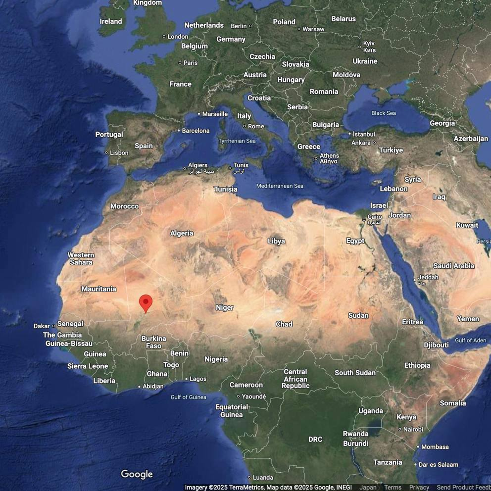
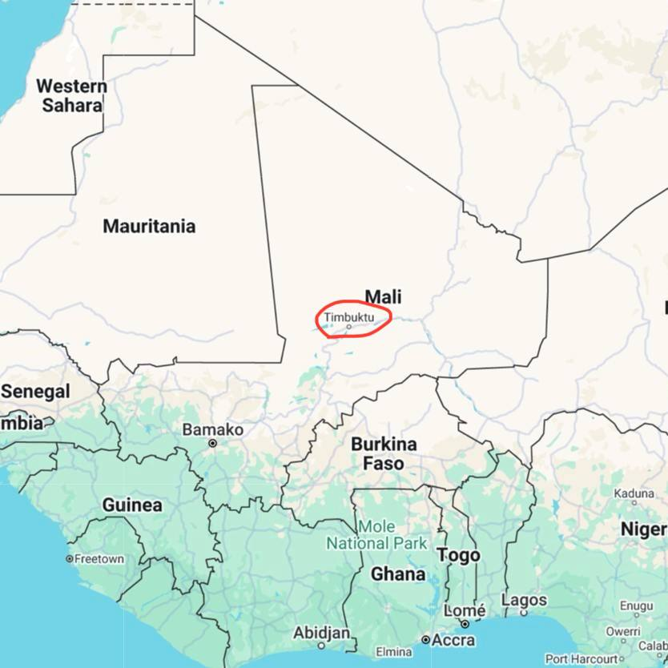
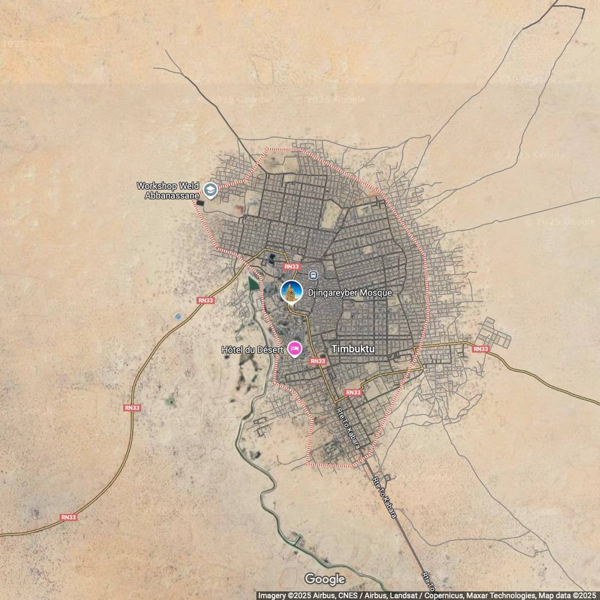
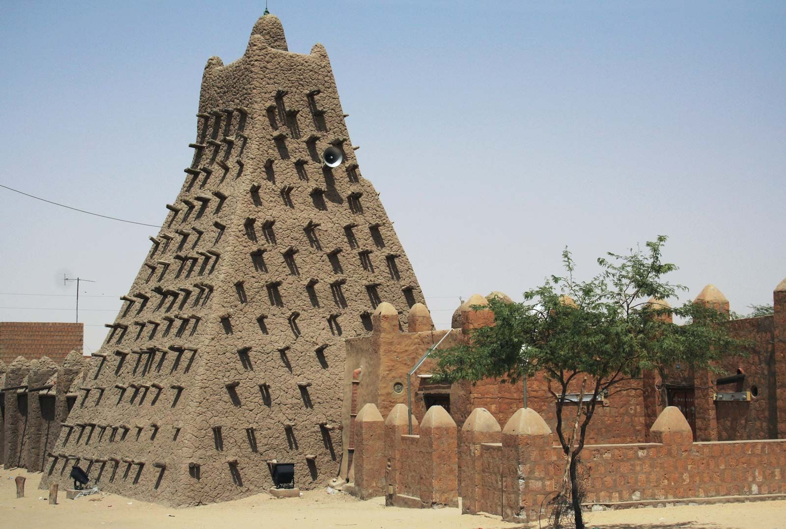
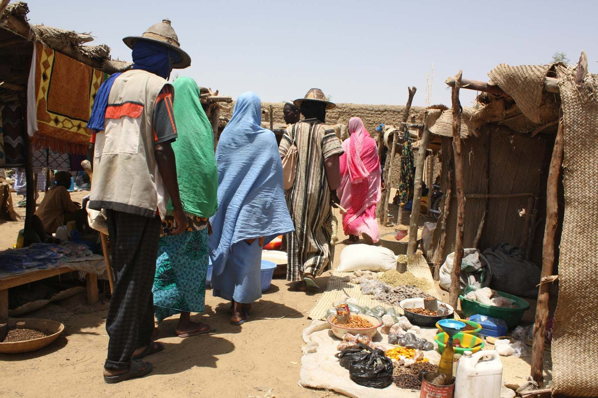
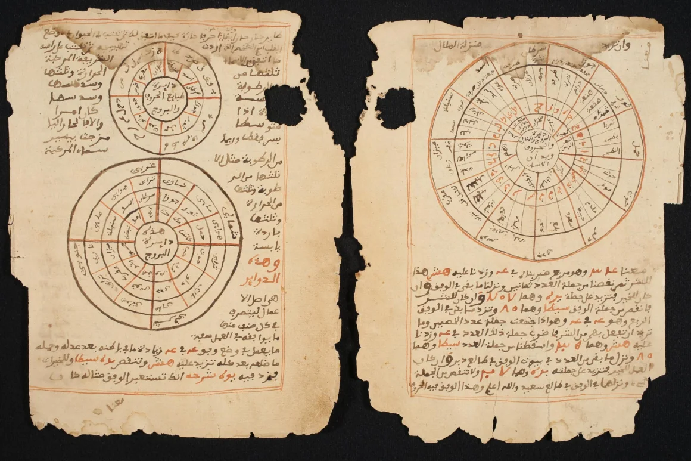



Timbuktu/Timbuctoo/Tambutum

<blockquote class="wp-block-quote is-style-default is-layout-flow wp-block-quote-is-layout-flow" style="font-size:13px;font-style:normal;font-weight:300;line-height:1.6">

布兰特迈着他那独特、从容、轻柔的步态走进房里。他中等身材，壮硕结实，红褐色的脸庞，面无表情，形容古怪，那双灰眼睛似乎总在眺望远方。他寡言少语，即便偶然开口也是结结巴巴，仿佛那些话是心不甘情不愿地从嘴里硬挤出来的。

“你好啊，谢泼德。”他以惯常的唐突口吻和我打了个招呼，然后就径直站到壁炉前，目光越过我们的头顶，俨然是在观赏远在<strong>廷巴克图</strong>发生的某件趣事。

“布兰特少校，”弗洛拉说，“讲讲那些非洲趣闻吧，你一定无所不知。”

《罗杰疑案》

</blockquote>

本文是有关廷巴克图的情报收集，包括“廷巴克图”这一地名在英语当中的象征意义、武装冲突对廷巴克图的影响、该地手稿的修复现状等内容。主要将相关外语网站的文本经由我设置过的ChatGPT翻译成中文，并简单收集罗列。目前（Mar 17, 2025）尚未检索相关学术文献资料。

本文内容较长，每份资料都收纳在折叠项目中，点击段落即可打开浏览，再次点击即可收纳。本文计划不定期更新材料。

<figure class="wp-block-image size-large"></figure>

Modern day Timbuktu by Maremagnum,

 <a href="https://education.nationalgeographic.org/resource/guide-timbuktu/">National Geographic Education</a>.

“现代的廷巴克图” 摄影：Maremagnum，

来源：国家地理教育。

点击阅览：“Timbuktu（廷巴克图）“的词源介绍。 为了在汉语环境下也能初步理解这个词，可以类比为“香格里拉”——既有实际的地理位置，同时该地名的象征意义又常常被使用；而且，其象征意义深入人心的程度往往盖过实际地名。不过廷巴克图要比香格里拉更加切实一些（当然，这也许是因为我并非英语母语者，从看到这个词一开始，就是从外部角度去考察这个词汇的）。由实到虚排序可以是：廷巴克图 &gt; 香格里拉 &gt; 亚特兰蒂斯/黄金国/等等，排名不严谨，仅作辅助理解。不过这或许可以作为一个课题，今后会补充考察社交媒体上的用户对于这类词的印象。 

<blockquote class="wp-block-quote is-style-default is-layout-flow wp-block-quote-is-layout-flow" style="font-size:13px;font-style:normal;font-weight:300;line-height:1.6">

<strong>城市背景</strong> 廷巴克图（Timbuktu）位于撒哈拉沙漠南缘，其早期拼写形式为“Timbuctoo”，最早可追溯至16世纪50年代（1550s），同时也有“Tambutum”等变体名称。该地名据说来源于松盖（Songhai）语，意为“凹地”（hollow），指的是这座城市所处的地势低洼地带。

<strong>作为象征意义的用法</strong> 自1863年以来，廷巴克图在英语中常被用作“遥远、难以到达之地”的象征。这是因为该地长期以来被认为是欧洲探险家难以进入的地方，在很长一段时间里几乎未曾有欧洲人成功抵达。

<strong>欧洲探险家对廷巴克图的探索</strong> 在《卡耶游记》（Caillié’s Travels）的附录中，有一份名单列出了过去两个半世纪里试图探索非洲内陆的探险家名单，其中包括25名英国人、14名法国人、2名美国人和1名德国人。以下是成功抵达廷巴克图的探险家：

<ul class="wp-block-list">
<li><strong>1670年</strong>：保罗·因贝尔（Paul Imbert），经由摩洛哥抵达廷巴克图。</li>
<li><strong>1810年</strong>：罗伯特·亚当斯（Robert Adams），从非洲西海岸进入廷巴克图。</li>
<li><strong>1827年</strong>：梅杰·莱因（Major Laing），经由的黎波里抵达廷巴克图。</li>
<li><strong>1827-1828年</strong>：雷内·卡耶（René Caillié），经由塞内冈比亚（Senegambia）进入廷巴克图。</li>
</ul>

<strong>参考文献</strong>：《文学镜报》（The Mirror of Literature），1830年4月10日，文章《中非廷巴克图城》（City of Timbuctoo, In Central Africa）

【来源信息】

网站：<a href="https://www.etymonline.com">Etymology Online</a>（英语在线词源字典网站）

标题：Timbuktu | Etymology of the name Timbuktu

作者：Etymology Online 编辑团队

发布时间：2024年4月15日

原文链接：<a href="https://www.etymonline.com/word/Timbuktu">https://www.etymonline.com/word/Timbuktu</a>

阅览时间：2025年3月16日

翻译：ChatGPT（基于GPT-4.5）依据用户规则翻译。

</blockquote>

<figure class="wp-block-image size-large is-resized has-custom-border wp-container-content-da09a7bf" style="margin-top:0;margin-right:0;margin-bottom:0;margin-left:0"></figure>
<figure class="wp-block-image size-large is-resized wp-container-content-69bc4bdf"></figure>
<figure class="wp-block-image size-large is-resized"></figure>

Geographical location of Timbuktu, 

Screenshot from Google Maps, captured on March 17, 2025.

廷巴克图地理位置，来源：Google地图，2025年3月17日截图。

点击阅览：大英百科有关廷巴克图的介绍。 简要了解廷巴克图动荡的历史。可以留意的是，14世纪繁荣时期，西非三座最古老的清真寺之中，有两座（金盖雷贝尔清真寺Djinguereber Mosque、以及下图的桑科雷清真寺Sankore Mosque）如今可以参观，是当地最主要的两个景点；有关当地的旅游资讯可以参考另外两条内容；不过我没有确认目前这个时间点（Mar 17, 2025）是否开放。时间向后推移，19世纪欧洲人的探险热潮成为了廷巴克图象征意义的源头所在。到了近现代，2012年的武装冲突使得全世界的目光重新聚焦于此，也让“廷巴克图”从最遥不可及的地方一下子跌落到纷乱的现实世界中去。

<blockquote class="wp-block-quote is-style-default is-layout-flow wp-block-quote-is-layout-flow" style="font-size:13px;font-style:normal;font-weight:300;line-height:1.6">
<h6 class="wp-block-heading"><strong>廷巴克图（Timbuktu）</strong></h6>

廷巴克图是西非马里共和国的一座城市，在历史上因其在撒哈拉商路上的贸易地位及其作为伊斯兰文化中心（约1400-1600年）而闻名。该城位于撒哈拉沙漠的南缘，距离尼日尔河约13公里（8英里）。廷巴克图在1988年被联合国教科文组织（UNESCO）列为世界文化遗产，而在2012年，由于当地武装冲突，它被列入《濒危世界遗产名录》。

<h6 class="wp-block-heading"><strong>起源与名称</strong></h6>

廷巴克图约在公元1100年由图阿雷格（Tuareg）游牧民族建立，最初是一个季节性营地。关于其名称的来源有多个说法，其中一种说法认为，这座城市的名字源自一位被留下看守营地的老妇人，她的名字被记作“Tomboutou”、“Timbuktu”或“Buctoo”，意为“有大肚脐的母亲”（可能指一种脐疝或其他身体特征）。廷巴克图处于沙漠与水源的交汇处，这一地理位置使其成为理想的贸易中心。13世纪晚期或14世纪初，它被纳入马里帝国（Mali Empire）。

<h6 class="wp-block-heading"><strong>繁荣时期（14世纪）</strong></h6>

14世纪时，廷巴克图成为撒哈拉金盐贸易的繁荣中心，并发展为伊斯兰文化重镇。西非三座最古老的清真寺——金盖雷贝尔清真寺（Djinguereber Mosque）、桑科雷清真寺（Sankore Mosque）和锡迪·叶海亚清真寺（Sidi Yahia Mosque）——均建于14世纪至15世纪初。1324年，马里帝国皇帝曼萨·穆萨（Mansa Mūsā）在完成他奢华的麦加朝圣之旅后，建造了金盖雷贝尔清真寺和一座皇家宫殿（后者如今已无存）。穆萨还委托来自格拉纳达的建筑师阿布·伊斯哈克·萨希利（Abū Isḥāq al-Sāḥili）设计了桑科雷清真寺，并在其周围建立了桑科雷大学（Sankore University）。这一清真寺至今仍然矗立，很可能是由于萨希利的设计理念——他在泥砖墙中加入了木质框架，使其可以在雨季后进行年度修缮。

1433年，图阿雷格人重新控制了廷巴克图，但他们并未在城市内部统治，而是从沙漠中遥控管理。尽管图阿雷格人定期征收大量贡品甚至进行掠夺，但廷巴克图的贸易与学术活动仍然兴盛。到1450年，该市人口已增至约10万人，其中约2.5万人是曾在麦加或埃及学习的学者。

<h6 class="wp-block-heading"><strong>统治更迭与衰落</strong></h6>

1468年，廷巴克图被桑海帝国（Songhai Empire）统治者索尼·阿里（Sonni ʿAlī）征服。索尼·阿里对当地的穆斯林学者不甚友好，但其继任者——阿斯基亚王朝（Askia Dynasty）的首位统治者穆罕默德·阿斯基亚（Muḥammad I Askia，统治时间1493–1528年）则利用学者作为法律和道德顾问。在阿斯基亚王朝统治时期（1493–1591年），廷巴克图达到了商业和学术发展的巅峰。北非商人纷纷前来，从事金盐交易，以及与塔加扎（Taghaza）地区的盐商和北非布匹、马匹交易。

1591年，廷巴克图被摩洛哥军队攻占，从此开始衰落。1593年，摩洛哥当局以不忠为由逮捕了大量学者，其中一些人在冲突中被杀，另一些则被流放至摩洛哥。更糟糕的是，摩洛哥在当地派驻的小型驻军未能提供有效的防御，廷巴克图随后屡遭班巴拉人（Bambara）、富拉尼人（Fulani）和图阿雷格人的袭击与占领。

<h6 class="wp-block-heading"><strong>19世纪欧洲探险</strong></h6>

19世纪初，欧洲探险家首次抵达廷巴克图。苏格兰探险家戈登·莱恩（Gordon Laing）于1826年成为第一位到达该城的欧洲人，但他在离开时被杀。1828年，法国探险家勒内-奥古斯特·卡耶（René-Auguste Caillié）以阿拉伯人身份伪装进入廷巴克图，并在此停留两周。他成为第一个带着廷巴克图的第一手资料返回欧洲的探险家。1853年，德国地理学家海因里希·巴特（Heinrich Barth）在长达五年的非洲探险中到达该城，并随后发表了自己的旅行记述。

<h6 class="wp-block-heading"><strong>近现代历史</strong></h6>

1894年，法国占领廷巴克图，部分恢复了这座城市，但并未修建铁路或铺设硬化道路。1960年，廷巴克图成为独立的马里共和国的一部分。

在20世纪末，为了应对沙漠化和建筑老化，廷巴克图开始对三座主要清真寺进行修复。然而，2012年，图阿雷格叛军在伊斯兰武装分子的支持下占领马里北部，并宣称包含廷巴克图在内的地区为独立国家“阿扎瓦德”（Azawad）。然而，伊斯兰武装分子很快取代了图阿雷格叛军，并在当地实施严格的伊斯兰教法（Sharīʾah）。其中，激进组织“安萨尔丁”（Ansar Dine）认为廷巴克图的历史宗教遗迹具有偶像崇拜的性质，因此破坏了包括金盖雷贝尔清真寺和锡迪·叶海亚清真寺在内的多个圣徒墓地。2013年初，这些武装分子被逐出廷巴克图，修复工作随即展开。

根据2009年的人口统计，廷巴克图共有54,453名居民。

【来源信息】

网站： <a href="https://www.britannica.com">Encyclopaedia Britannica</a>《大英百科全书》在线版

标题： Timbuktu | History, Map, Population, &amp; Facts

作者： The Editors of Encyclopaedia Britannica

发布时间： 2025年3月16日（最近更新）

原文链接： <a href="https://www.britannica.com/place/Timbuktu-Mali">https://www.britannica.com/place/Timbuktu-Mali</a>

阅览时间： 2025年3月17日

翻译： ChatGPT（基于GPT-4.5）依据用户规则翻译。

</blockquote>

<figure class="wp-block-image"></figure>

Sankore Mosque, <a href="https://www.britannica.com/place/Timbuktu-Mali">Encyclopaedia Britannica</a>.

桑科雷清真寺，来源：《大英百科全书》在线。

点击阅览：2012年BBC新闻对廷巴克图的介绍。 文中简要提到阿加莎在小说中对廷巴克图象征意义的强化，应该就是开头《罗杰疑案》的这部分引用。通过这篇报道可以理解“廷巴克图”是如何由虚变实的。

<blockquote class="wp-block-quote is-style-default is-layout-flow wp-block-quote-is-layout-flow" style="font-size:13px;font-style:normal;font-weight:300;line-height:1.6">
<h6 class="wp-block-heading"><strong>谁、什么、为什么：我们为何知道廷巴克图？</strong></h6>

马里境内的叛军已占领历史名城廷巴克图（Timbuktu），一个在英语中几乎成了“遥远之地”代名词的地方。这种隐喻是如何形成的？

<strong>“天啊！刚刚才发现廷巴克图居然是真实存在的地方！”</strong>

马里境内发生的新闻——图阿雷格（Tuareg）族武装占领廷巴克图，让一些推特用户困惑不已，他们之前甚至不知道这个地方是真实存在的。

尽管有些人对图阿雷格人略有了解，但几乎所有人都对“廷巴克图”这个地名耳熟能详，即使他们一直以为它只是个神话中的地点。

廷巴克图的拼写曾为“Timbuctoo”，它在马里北部，如今成为“遥远尽头之地”的象征。

根据《牛津英语词典》（OED），廷巴克图被定义为“最遥不可及的地方”。

这一隐喻的首次书面记录可追溯到 1863 年。当时的英国作家<strong>达夫-戈登夫人</strong>（Lady Duff-Gordon）在她的《埃及书简》（Letters from Egypt）中提到，在她身处埃及首都开罗时，曾写道：

<blockquote class="wp-block-quote is-layout-flow wp-block-quote-is-layout-flow">

<strong>“这里正变得越来越伦敦化，我必须去廷巴克图了。”</strong>

</blockquote>

随后，不同类型的作家——包括<strong>D.H. 劳伦斯</strong>（D.H. Lawrence）、<strong>阿加莎·克里斯蒂</strong>（Agatha Christie）以及《神奇先生》系列的创作者<strong>罗杰·哈格里夫斯</strong>（Roger Hargreaves）——都在各自的书中进一步强化了这种象征意义。

D.H. 劳伦斯在 1930 年的最后作品之一《荨麻》（Nettles）中写道：

<blockquote class="wp-block-quote is-layout-flow wp-block-quote-is-layout-flow">

<strong>“整个世界对此毫不在意， 无论他的血统来自英国，还是廷巴克图。”</strong>

</blockquote>

其他类似的表达方式还包括“从这里到廷巴克图”（from here to Timbuktu，意指一段极其漫长的旅程），以及“从廷巴克图到卡拉马祖”（from Timbuktu to Kalamazoo，卡拉马祖是美国密歇根州的一个城市）。

<h6 class="wp-block-heading"><strong>为何是廷巴克图？</strong></h6>

廷巴克图最早由图阿雷格游牧民族在 12 世纪建立，仅仅 200 年后，它便发展为一个极其富庶的城市，成为盐与黄金贸易的重要枢纽。

通过作家<strong>利奥·阿非利加努斯</strong>（Leo Africanus）的记录，关于廷巴克图财富的传说传入欧洲，引发了欧洲探险家的极大兴趣。

这种神秘感因其难以抵达而愈发强烈。许多欧洲探险队在试图抵达廷巴克图的过程中遭遇不测，使它长时间成为遥不可及的地方。

<strong>“在 1830 年欧洲人真正踏足廷巴克图之前，所有关于它的文献都在描述如何到达它。”</strong> ——《牛津英语词典》修订编辑<strong>理查德·夏皮罗</strong>（Richard Shapiro）

<blockquote class="wp-block-quote is-layout-flow wp-block-quote-is-layout-flow">

<strong>“1820 年，人们说从的黎波里（今利比亚首都）到廷巴克图需要 60 天，其中只有 6 天能找到水。”</strong> <strong>“廷巴克图是个传奇般的富庶之地，英国人曾希望能像西班牙从南美洲掠夺黄金一样，从非洲获取类似的财富。”</strong>

</blockquote>

在 1829 年，<strong>阿尔弗雷德·丁尼生</strong>（Alfred Tennyson）在其诗歌《廷巴克图》（Timbuctoo）中将其描述为“神秘”和“不可捉摸”的地方，并将其与<strong>埃尔多拉多</strong>（El Dorado，传说中的黄金城）和<strong>亚特兰蒂斯</strong>（Atlantis，传说中的沉没大陆）相提并论。

直到 1830 年，在廷巴克图早已衰落之时，才有第一位欧洲人完成了去往廷巴克图并安全返回的旅程——<strong>法国探险家雷内·卡伊耶</strong>（René Caillié）。

<h6 class="wp-block-heading"><strong>探险家的执念</strong></h6>

<strong>“欧洲人对廷巴克图的探索来得非常晚。”</strong> ——<strong>玛丽·罗代</strong>（Marie Rodet），伦敦大学亚非学院（SOAS）讲师

<blockquote class="wp-block-quote is-layout-flow wp-block-quote-is-layout-flow">

<strong>“几个世纪以来，他们不断尝试抵达那里，因为廷巴克图不仅是一个传奇的贸易中心，还是一个伊斯兰学术圣地。”</strong> <strong>“阿拉伯中世纪文献曾详细描述廷巴克图的历史，因此欧洲人知道它的存在，但当地居民始终不让他们进入。”</strong>

</blockquote>

当地人认为廷巴克图是**“333 位圣徒之城”<strong>，而基督徒被视为敌人。因此，雷内·卡伊耶不得不伪装成穆斯林进入该城。而比他早四年到达的苏格兰探险家</strong>亚历山大·戈登·莱因**（Alexander Gordon Laing）据说在离开前被谋杀。

即使在全球化高度发达的今天，廷巴克图仍然相对偏远。

<strong>“你几乎可以去任何地方，但廷巴克图仍然很难抵达。”</strong> ——<strong>理查德·特里洛</strong>（Richard Trillo），《西非旅游指南》（Rough Guide to West Africa）作者

如今，这里依然没有通往廷巴克图的柏油公路。特里洛回忆起自己 1977 年第一次前往廷巴克图的经历，当时他 21 岁，从英国汉普郡（Hampshire）一路搭便车到达这里，整趟旅程历时近六周，最终还乘坐了一艘尼日尔河上的小船，随后搭乘当地警察局长提供的一辆卡车才成功抵达。

<blockquote class="wp-block-quote is-layout-flow wp-block-quote-is-layout-flow">

<strong>“撒哈拉以南的非洲，与阿拉伯世界完全不同。感觉就像是跨越了一片海洋，来到了这片广阔大陆的边缘。廷巴克图给人的感觉极其遥远。”</strong>

</blockquote>

特里洛认为，廷巴克图神话得以延续，是因为它在 17 至 18 世纪陷入衰落后**“从地图上消失”**。摩尔人（Moors）离开后，贸易路线发生变化，使廷巴克图逐渐被世界遗忘。

<blockquote class="wp-block-quote is-layout-flow wp-block-quote-is-layout-flow">

<strong>“廷巴克图在沙漠中生存了 200 年，但它与世界完全脱节。这正是为何它成为神话的原因。”</strong> <strong>“想象一下，如果纽约突然被水淹没 200 年，但人们仍在谈论它。”</strong> <strong>“正是那时，探险家们的竞赛开始了，所有人都想成为第一个抵达廷巴克图的人。”</strong>

</blockquote>

【来源信息】

网站：<a href="https://www.bbc.co.uk/news">BBC News</a>

标题：Who, What, Why: Why do we know Timbuktu?

作者：Tom Geoghegan

发布时间：2012年4月3日

原文链接：<a href="https://www.bbc.co.uk/news/magazine-17583772">https://www.bbc.co.uk/news/magazine-17583772</a>

阅览时间：2025年3月17日

翻译：ChatGPT（基于GPT-4.5）依据用户规则翻译。

</blockquote>

点击阅览：2014年卫报对廷巴克图衰败的担忧。 其中提到卫报摄影师是当地某旅社的唯一住客。有关廷巴克图的旅游住宿情报收集在另两条。

<blockquote class="wp-block-quote is-style-default is-layout-flow wp-block-quote-is-layout-flow" style="font-size:13px;font-style:normal;font-weight:300;line-height:1.6">

<strong>通往廷巴克图的道路：一座被沙尘封锁的城市</strong>

哈穆迪·“贾格尔”·贝比（Hamoudi “Jagger” Baby）已经割喉宰牲三十年了。此刻，他蹲在沙丘上，等待着下一次工作，似乎对荆棘树后面那群兴奋的人群视而不见。十米开外，一群十来岁的少年正合力将一头动物摁倒在地。

这位45岁的屠宰者身穿一件沾满鲜血的蓝色T恤。人们说他得名“贾格尔”是因为他跳舞时像一名滚石乐队的成员。他手中的刀锋早已被磨得不成形，刀柄也被血浸透。

有人喊道：“贾格尔！”人群立刻让开了一条通往屠宰场的通道。那头骆驼的蹄子已经被捆绑在一起，安静无声，所有人都屏住了呼吸。贾格尔慢悠悠地走上前，轻声念道“Allahu Akbar”（真主至大），随后迅速挥刀，在骆驼的脖子上划了两刀。

鲜血从仍在抽搐的动物体内涌出，在苍白的沙地上汇聚成一片深红色的湖泊。贾格尔这才开口：“我们并不以宰杀骆驼为荣，这只骆驼还很年轻。但这个季节牛不够多，因为雨水太少了。过去，这里一年四季都能放牧。1973年大旱之前，这里甚至还有树。”他说着，指向城市北端那些光秃秃的沙丘。

<strong>廷巴克图，黄金之城，正在慢慢化为尘埃</strong>

廷巴克图，这座昔日的黄金之城、古代学术中心，正一点点消失在沙尘之中。撒哈拉沙漠的扩张正在吞噬它的生命力，而当地居民知道，这不仅仅是自然因素导致的。廷巴克图正处于生存的边缘，原因还包括人为的忽视、战争与贪婪。欠发达与腐败，是加剧荒漠化的幕后推手。这座城市不仅在物理上被围困，也在精神上被沙尘所封锁。

在更富裕的年代，长途跋涉穿越沙漠来到此地的旅人，会被挂满金色果实的芒果树迎接，一条条纵横交错的运河让空气变得清新。16世纪的文献描绘了一座宛如仙境的半岛，阿拉伯人与非洲人在这里以盐换黄金。人们的敬畏与财富共同筑起了辉煌的清真寺和繁荣的学术氛围。19世纪，欧洲探险家们为了抵达这里甚至不惜付出生命。廷巴克图在全球的想象中成了一座神秘到近乎虚幻的城市。

如今，前来廷巴克图的访客大多从南方进入。这座城市自2012-2013年被分裂主义者与与基地组织（Al-Qaida）有关的伊斯兰极端分子占领以来，便一直处于武装控制之下。从马里首都巴马科（Bamako）出发，600英里（约960公里）的旅途危险重重。每年只有三个月，尼日尔河上的轮船可以通航。记者被建议搭乘联合国的每日航班进入廷巴克图，因为当地没有对公众开放的民航班机。

<strong>廷巴克图的色调：一座“褪色”的城市</strong>

廷巴克图是一座“米黄色”的城市。街道上的沙尘比泥砖墙的颜色仅仅浅了一点。唯一的色彩变化来自稀疏的荆棘树，它们的叶子呈现出淡淡的绿色，而当头戴钢盔的联合国维和部队驾驶车辆驶过时，天空映衬出的则是点点蓝色。目前，联合国在廷巴克图部署了1200名维和人员，而当地的人口估计已不足1.5万。

廷巴克图如今是否还配得上“城市”之名，令人质疑。《卫报》的摄影师肖恩·史密斯（Sean Smith）是此地“鸽舍旅馆”（La Colombe Hotel）唯一的住客。到了晚上，连旅馆经理都回家了，只留下他一个人独处。而在历史上，廷巴克图最辉煌的时期曾拥有2.5万名学生，12世纪时便已建立世界上最早的大学之一。

<strong>一座沉默的城市</strong>

如今，这座城市宛如死寂，沙尘和炽热的空气共同压抑了声音（每年夏季，这里的气温会飙升至40℃以上）。这里的节奏缓慢，既没有红绿灯，车也极为罕见。廷巴克图的主要交通工具是驴车，仅有几辆破旧的路虎车（Land Rover）在市区与南部的尼日尔河之间来回行驶。运河的水源曾经来自尼日尔河，但1955年后，它再也无法全年供水。

廷巴克图的居民面临两个选择：适应，或者离开。随着运河干涸，雨季带来的风沙越来越多，马哈曼·阿尔法迪（Mahamane Alphady）的父亲——“或者说是我祖父”——当年挖了一个坑来存水。许多市场里的园艺师都采取了同样的做法，他们挖了数十个坑，以收集运河的余水，并在坑壁上种植蔬菜。然而，每年他们都不得不挖得更深。1973年，马哈曼的父亲最终放弃了。

“他让我去政府部门找一份工作。”51岁的马哈曼回忆道，“于是，我成了街道清洁工。我们家的水坑是最后一个仍能存水的，后来我们再也没想过它还能重新见水。”

然而，今天，廷巴克图西端的阿尔法迪水坑再一次积满了水。在围起的深坑内，种植着“花生、土豆、小米、西瓜、薄荷、西红柿——想种什么就能种什么。”他的妻子在市场上卖这些蔬果，他们的九个孩子也因此能保持健康的饮食。

但这种幸运只是暂时的。阿尔法迪家的水坑，靠近一座酒店——这座酒店在十年前被利比亚前领导人卡扎菲（Muammar Gaddafi）买下。卡扎菲觉得酒店缺少水景，于是在2006年派遣大型机械设备，重新挖掘廷巴克图运河，并延伸至尼日尔河。

“卡扎菲把鸟儿带回了廷巴克图。”马哈曼骄傲地说，“我终于能回归自己的职业。我供得起孩子们上学，能让他们有个值得期待的未来。”

但廷巴克图地方历史学家萨利姆·乌尔德·埃尔哈吉（Salem Ould Elhadje），同时也是两本关于廷巴克图历史书籍的作者，对此故事有不同的看法。他解释道：“卡扎菲确实在那一年带回了水，但如今——除了尼日尔河泛滥的三个月之外——运河早已变回了一条干涸的沙沟，水闸系统也彻底失效。”

“许多遏制沙漠化的努力最终都失败了。1990年代，机场周围曾种植了一圈围栏和树木，但在2012年危机期间，这些树木都被砍掉当柴火烧了。”

<strong>“危机”之后的廷巴克图</strong>

“危机”——这是马里人对2012年3月军事政变的称呼。这场政变导致马里北部被叛乱武装占领，伊斯兰极端分子随之推行严厉的伊斯兰教法（Sharia），并摧毁了廷巴克图的部分古老陵墓和手稿。2013年1月，前殖民宗主国法国出兵干预，随后联合国也派遣了1万名士兵与警察进驻。然而，至今，马里北部的和平协议仍未达成。

<strong>在沙漠中生存</strong>

哈乌萨·坦迪纳（Haoussa Tandina）不愿谈论气候变化。“这是安拉的旨意。”她耸耸肩说道，“我们是沙漠中的人，懂得如何适应。我们喜欢炎热，南方那种潮湿、蚊虫肆虐、疾病横行的环境才是让人受不了的。”

35岁的哈乌萨是家中的经济支柱。她的丈夫乌玛·“杰克斯”（Oumar “Jex”），50岁，曾是酒店清洁工，但当恐怖分子取代游客后，他便失业了。夫妻俩育有五个孩子，哈乌萨靠着多个小生意养家糊口。此刻，她正和17岁的塔塔（Tata）一起忙碌地往小塑料袋里装水，然后打结封口。这些小水袋将在家中的唯一一处水龙头下冻结成冰——这是她的一项副业。此外，她还卖布料和服装。

目前，她那座14世纪的双层泥砖房附近相对安全。但哈乌萨说，叛军仍然藏身城中——他们虽然暂时沉寂，但活跃在廷巴克图外围。而每晚6点半至次日早晨7点的宵禁检查站，根本无法阻挡他们的活动。

6月30日，当哈乌萨最后一次从巴马科返回廷巴克图时，半路遭遇了持枪劫匪。

“大概是晚上8点。我们听到了机关枪的扫射声。他们用一辆卡车拦住了路，命令所有人下车，趴在地上，双手反绑在背后。他们抢走了我所有的货物、手机，还有一些我买来准备转售的银项链。总价值大约19万西非法郎（约合230英镑）。”

<strong>战争与生计的冲突</strong>

2012年4月至2013年1月叛军统治期间，哈乌萨曾带着家人南逃，与成千上万名廷巴克图难民一道避难。

“一开始，武装分子看起来还不算太糟。”她回忆道，“他们带来了秩序。整个城市突然有了严格的法规——他们只砍掉了一个小偷的手，禁止饮酒，还强迫所有人遵守单行道规则。这对我们来说倒是一种新鲜的变化，因为我们早就厌倦了政府的腐败和裙带关系。”

但好景不长。“有一天，其中一个武装分子拿着枪闯进我家，他指责塔塔穿得不合规矩，想要带她去他们的监狱——我们知道，那里会对女孩施以鞭刑，甚至强暴她。”

“当天晚上，我们就逃往了塞古（Ségou）。流亡期间，我欠下了一大笔债。”

<strong>廷巴克图的经济危机</strong>

19岁的西迪·迈加（Sidi Maiga）来买冰块了。他骑着摩托车挨家挨户收购这些冰块，每块买价25西非法郎（约合0.03英镑），然后载到南部的尼日尔河，卖给渔民和市场里的小商贩，每块卖50西非法郎。这门小本生意在廷巴克图算是不错的赚钱方式——毕竟，这里的面包一条要卖150西非法郎。

然而，迈加挑剔地检查了一下冰块，拒绝了一部分。“不够冻。”他说。

哈乌萨怒气冲冲地抱怨马里国家电力公司（EDM）：“他们欺骗了我们！廷巴克图是马里唯一一个被强制安装预付费电表的地方，其他城市的居民都是自愿的。而且，他们只给我们5安培的电力，导致我们的冰柜制冷效果变差，还把电费提了上去！”

<strong>国家的无能与腐败</strong>

在廷巴克图，政府机构、电力公司、银行和司法体系都被视为一个腐败的中央政府的延伸——这个政府自1960年马里独立以来就一直忽视廷巴克图。马里政府甚至从未进行过地质勘测，以确定廷巴克图的地下水资源。

前往尼日尔河的道路状况极差：全长12英里（约19公里）的柏油路遍布巨大的坑洞，驾驶车辆需要绕行避开。而就在几天前，廷巴克图机场还遭到了三枚122毫米火箭弹的袭击。然而，那些驾驶破旧路虎车往返于河岸的商贩们却毫不畏惧。

“他们想吓走联合国和法国人。”一位商贩说，“他们的目标是切断廷巴克图与外界的联系，以便继续控制这里的经济。”

“‘他们’是谁？”记者问道。

“阿拉伯人、图阿雷格人、武装组织……可能是阿扎瓦德民族解放运动（MNLA），也可能是其他组织，比如‘安萨尔丁’（Ansar Dine）或‘伊斯兰马格里布基地组织’（AQIM）。他们受制于贩毒集团。这些组织在政治上各有分歧，但在走私食品、武器、人口甚至可卡因时，他们是同伙。”

<strong>廷巴克图的“隐形”贸易</strong>

在廷巴克图以南，沿着尼日尔河，托亚（Toya）市场熙熙攘攘。在这里，阿尔及利亚的“American Legend”香烟与新鲜或风干的鱼并列销售，甚至还有联合国提供的救援食品——比如花生和大豆制成的营养补充剂“Plumpy’Nut”。

“这些援助物资本不该出现在这里。”一位年轻的阿拉伯商人穆罕默德·“布纳”·马乌鲁德（Mohamed Maouloud “Bouna” Sidi Mohamed）抱怨道，“这些商贩低价出售联合国的食用油，影响了我们从毛里塔尼亚进口的生意。我无法把价格降到他们的水平，因为我们的成本更高。”

布纳的家族经营着三辆十吨级卡车，在阿尔及利亚、廷巴克图和毛里塔尼亚之间往返运输。他坦言，他们的货物包括布料、毛毯、走私柴油和香烟，最近最受欢迎的是阿尔及利亚生产的“Eniem”品牌冰箱，在廷巴克图的售价为16.5万西非法郎。

“人贩子和毒贩不是我们。”他强调道，“但这个地方就是个西部荒野。腐败无处不在。无论是持枪的强盗、市长、酋长，还是穿制服的宪兵、军人、海关官员，每个人都要收钱。”

“马里政府对自己的领土毫无控制力，别人自然就乘虚而入了。”

<strong>廷巴克图的市长：一个“无权”的领导者</strong>

哈莱·乌斯曼（Hallé Ousman）已经担任廷巴克图市长八年了，但他说自己几乎没有从巴马科政府那里得到任何帮助。

“我们基本上靠着少数国际捐助者和四座姊妹城市的支持才能生存。”他说。这四座城市分别是英国以书店闻名的小镇海伊（Hay-on-Wye）、法国的圣特（Saintes）、美国亚利桑那州的坦佩（Tempe），以及德国的开姆尼茨（Chemnitz）。

乌斯曼认为，马里最大的难题在于人们彼此不信任。“我们需要坐下来好好谈谈——所有人，不论肤色，不论身份，游牧的、定居的，全都要参与。”他说。

“那么，为什么你不率先推动这个对话？”记者问道。

“我试过。”乌斯曼叹了口气，“但马里北部的混乱状态对某些有权有势的人来说是有利的。和他们比起来，我不过是个微不足道的小市长。”

乌斯曼的梦想之一，是一条连接廷巴克图和巴马科的柏油公路，让廷巴克图的居民能够消费马里自产的糖，而不是靠走私来的阿尔及利亚白糖。目前，欧洲联盟已经承诺提供资金修建这条公路，但由于当地的安全局势不稳定，工程无法启动。

他还希望恢复廷巴克图的旅游业。曾几何时，这座城市以“沙漠中的音乐盛会”著称，每年举办的**“沙漠音乐节”**（Festival au Désert）吸引着世界各地的游客。然而，2011年，一名游客在音乐节期间被杀害，另有三人被绑架。自此，音乐节停办至今。

<strong>廷巴克图的“王牌”：国际社会的关注</strong>

尽管廷巴克图正在走向衰亡，它仍然拥有一个强大的资本：它的名字。“廷巴克图”这四个字，足以激发遥远国度里无数人的想象力和同情心。

在返回巴马科的联合国航班上，记者偶遇了一支特殊的访问团：<strong>谷歌文化研究院</strong>（Google Cultural Institute）的代表——该机构以数字化世界文化遗产闻名。他们的随行人员还包括一名音乐策划人，以及一位特殊人物——辛西娅·施奈德（Cynthia Schneider）。

施奈德曾是一名美国外交官，如今致力于推进“廷巴克图复兴计划”（Timbuktu Renaissance Initiative），她的目标是让廷巴克图恢复其昔日作为“宽容、智慧与创新灯塔”的地位。

然而，现实情况是，廷巴克图正逐渐被边缘化，缓慢地消失在历史与沙尘之中。半个多世纪以来，这座城市饱受荒漠化侵袭，而过去人们曾经有机会拯救它——他们本可以重新种植金色果实的芒果树，让运河重新流淌。然而，这一切都被错失了。如今，廷巴克图的血脉中流淌的不是清澈的水，而是糟糕的治理和贪腐。

让谷歌的街景车（Google Street View）拍摄虚拟游览画面，或许听起来荒诞不经。但廷巴克图确实需要重新回到世界地图上——否则，它将最终沦为一个只存在于传说中的地名。

【来源信息】

网站：《卫报》<a href="https://www.theguardian.com/international">The Guardian</a>

标题：Life in Timbuktu: how the ancient city of gold is slowly turning to dust

作者：Alex Duval Smith

摄影：Sean Smith / 《卫报》

发布时间：2014年9月16日

原文链接：<a href="https://www.theguardian.com/cities/2014/sep/16/-sp-life-timbuktu-mali-ancient-city-gold-slowly-turning-to-dust">https://www.theguardian.com/cities/2014/sep/16/-sp-life-timbuktu-mali-ancient-city-gold-slowly-turning-to-dust</a>

阅览时间：2025年3月17日

翻译：ChatGPT（基于GPT-4.5）依据用户规则翻译，翻译结果微调。

</blockquote>

点击阅览：Wikivoyage（旅行维基百科）对廷巴克图旅行注意事项的介绍。 由志愿者共同维护的旅行百科网站，没有商业广告干扰。

<blockquote class="wp-block-quote is-style-default is-layout-flow wp-block-quote-is-layout-flow" style="font-size:13px;font-style:normal;font-weight:300;line-height:1.6">
<h3 class="wp-block-heading"><strong>廷巴克图旅行指南</strong></h3>

<strong>廷巴克图</strong>（Timbuktu，亦作 Tombouctou 或 Timbuctu）是位于马里尼日尔河沿岸的一座图阿雷格城市。

<blockquote class="wp-block-quote is-layout-flow wp-block-quote-is-layout-flow">

“我爸爸也能读大词，比如……君士坦丁堡（Constantinople）和廷巴克图（Timbuktu）。” ——苏斯博士（Dr. Seuss），1963年，《跳上跳下》（Hop on Pop）

</blockquote>

这座城市历史悠久，曾是一个贸易中转站，连接撒哈拉沙漠以南的黑人非洲与整个北非的柏柏尔人和伊斯兰商人，间接也与欧洲商人相连，使其成为一个传奇之地。再加上其相对偏远的地理位置，“廷巴克图”一词已成为“遥远、神秘之地”的代名词。廷巴克图曾是<strong>马里帝国</strong>（Mali Empire）的首都，并且是历史上最富有的人之一——<strong>曼萨·穆萨</strong>（Mansa Musa）的故乡。

如今，廷巴克图是一个贫困的城镇，但因其盛名仍吸引游客，并设有机场。它是马里八个行政大区之一，也是当地州长的驻地，并与马里另一座历史名城<strong>杰内</strong>（Djenne）互为姊妹城市。

<h3 class="wp-block-heading"><strong>世界遗产地位与文化损毁</strong></h3>

廷巴克图自<strong>1988年</strong>起被列为<strong>联合国教科文组织世界遗产</strong>（UNESCO World Heritage Site）。1990年，该城市因受沙漠化威胁，被列入濒危世界遗产名录。尽管此后实施了一系列保护措施，并在2005年被移出濒危名单，但2012年和2013年初，极端伊斯兰主义者对该地区文化遗产造成了无法估量的破坏，摧毁了大量文化遗址。被极端分子摧毁的14座<strong>苏菲派陵墓</strong>（Sufi mausoleums）已于2015年重建，但整个城市仍然受到破坏的影响。

<h3 class="wp-block-heading"><strong>交通方式</strong></h3>
<h4 class="wp-block-heading"><strong>如何抵达</strong></h4>
<ul class="wp-block-list">
<li><strong>陆路</strong>：
<ul class="wp-block-list">
<li>从<strong>莫普提（Mopti）出发，驾车需12至24小时</strong>。</li>
<li>从<strong>加奥（Gao）穿越沙漠前往廷巴克图需四驱越野车</strong>，路况较为艰难。</li>
</ul>
</li>
<li><strong>水路</strong>：
<ul class="wp-block-list">
<li><strong>旅游船</strong>（pinnace）：从莫普提出发需<strong>三天</strong>，相对舒适，船上有厕所，晚上会在岸边露营。</li>
<li><strong>本地船只</strong>：较为拥挤，但价格便宜。</li>
</ul>
</li>
<li><strong>航空</strong>：
<ul class="wp-block-list">
<li><strong>天空马里航空（Sky Mali）提供巴马科（Bamako）与加奥</strong>往返廷巴克图的航班，使用波音737飞机，每周两次，但航班可能会取消。</li>
</ul>
</li>
</ul>
<h4 class="wp-block-heading"><strong>市内交通</strong></h4>
<ul class="wp-block-list">
<li><strong>步行</strong>：城市不大，从一端步行至另一端不到<strong>一小时</strong>。</li>
<li><strong>出租车、骆驼和驴车</strong>可供选择。</li>
<li><strong>主要清真寺</strong>位于老城区，步行即可到达。</li>
</ul>
<h3 class="wp-block-heading"><strong>文化遗址</strong></h3>
<ul class="wp-block-list">
<li><strong>三座清真寺</strong>（并称“廷巴克图大学”）：
<ol class="wp-block-list">
<li><strong>京吉雷贝尔清真寺</strong>（Djinguereber Mosque）：建于<strong>1327年</strong>，为三座清真寺中<strong>最大</strong>、<strong>最宏伟</strong>的一座。清真寺南侧设有军营，拍照需谨慎。</li>
<li><strong>西迪·叶海亚清真寺</strong>（Sidi Yahya Mosque）：建于<strong>1400年</strong>，典型的苏丹-萨赫勒式泥土建筑。2012年曾部分毁坏，现已重建。</li>
<li><strong>桑科雷清真寺</strong>（Sankore Mosque）：设有<strong>高耸的宣礼塔</strong>，兼作<strong>伊斯兰教学中心</strong>（madrasah）。</li>
</ol>
</li>
<li><strong>著名探险家的故居</strong>：
<ul class="wp-block-list">
<li><strong>海因里希·巴特之家</strong>（Heinrich Barth’s House）：德国探险家巴特曾在1853年抵达廷巴克图，该小型博物馆展示其绘画及文字记录。</li>
<li><strong>亚历山大·戈登·莱恩故居</strong>（Gordon Laing House）：1826年，英国探险家莱恩成为<strong>首位抵达廷巴克图的欧洲人</strong>，但不久后遇害。</li>
<li><strong>雷内·卡伊耶故居</strong>（René Caillié House）：法国探险家卡伊耶于1828年成为<strong>首位抵达廷巴克图并成功返回欧洲的探险家</strong>。</li>
</ul>
</li>
<li><strong>纪念遗址</strong>：
<ul class="wp-block-list">
<li><strong>民族学博物馆</strong>（Timbuktu Ethnological Museum）：收藏民族工艺品，并包括<strong>布克图之井</strong>（Bouctou’s Well），据传城市围绕此井而建。</li>
<li><strong>和平之火纪念碑</strong>（Flamme de la Paix）：1996年，为纪念图阿雷格叛乱结束，焚毁了<strong>3000件武器</strong>，并将枪支埋入纪念碑基座。</li>
</ul>
</li>
</ul>
<h3 class="wp-block-heading"><strong>购物与纪念品</strong></h3>
<ul class="wp-block-list">
<li><strong>市场</strong>：**大市场（Grand Marché）**提供各种商品，并可在屋顶欣赏廷巴克图全景。</li>
<li><strong>特色商品</strong>：
<ul class="wp-block-list">
<li><strong>图阿雷格匕首、刀剑</strong></li>
<li><strong>盐块</strong></li>
<li><strong>传统手工艺品</strong>（首饰、耳环、纪念品等）——建议<strong>砍价</strong>，通常可从开价的1/3起谈，最终成交价约为<strong>原价的一半</strong>。</li>
</ul>
</li>
<li><strong>便宜购物点</strong>：从<strong>Colombe酒店</strong>北行至岔路，选择左侧岔路，前行100-200米，可找到当地商贩的进货商店，价格比市场便宜<strong>6-10倍</strong>。</li>
</ul>
<h3 class="wp-block-heading"><strong>旅游小贴士</strong></h3>
<ul class="wp-block-list">
<li><strong>邮寄明信片</strong>：可在邮局购买并寄出廷巴克图盖戳的明信片，但寄往西方国家可能需<strong>一个月</strong>以上。</li>
<li><strong>护照盖章</strong>：可前往<strong>旅游办公室</strong>盖廷巴克图印章。</li>
<li><strong>饮食</strong>：
<ul class="wp-block-list">
<li><strong>避免饮用当地自来水</strong>，建议喝瓶装水或<strong>煮沸</strong>后再饮用。</li>
<li>当地酒店、市场提供**可乐（Coca Cola）、芬达（Fanta）**等西式饮料。</li>
</ul>
</li>
<li><strong>安全</strong>：
<ul class="wp-block-list">
<li><strong>2012年叛乱后</strong>，部分商店和旅馆可能已关闭，建议事先确认。</li>
<li><strong>避免夜间单独外出</strong>，听从当地人建议。</li>
</ul>
</li>
</ul>

【来源信息】

网站：<a href="https://en.wikivoyage.org/wiki/Main_Page">Wikivoyage</a>

标题：Timbuktu – Travel guide at Wikivoyage

原文链接：<a href="https://en.wikivoyage.org/wiki/Timbuktu">https://en.wikivoyage.org/wiki/Timbuktu</a>

阅览时间：2025年3月17日

翻译： ChatGPT（基于GPT-4.5）依据用户规则翻译。

</blockquote>

点击阅览：Tripadvisor（旅游信息和用户评价平台）上有关廷巴克图的景点和住宿的评价。 看一看比较有意思，会有一些实感。都是网友个人意见，仅供参考。 

<blockquote class="wp-block-quote is-style-default is-layout-flow wp-block-quote-is-layout-flow" style="font-size:13px;font-style:normal;font-weight:300;line-height:1.6">
<h3 class="wp-block-heading has-text-align-left">Sankore 清真寺 (Mosque of Sankore) 用户评价</h3>
<h4 class="wp-block-heading"><strong>hondo533（墨尔本，澳大利亚）</strong></h4>

<strong>评价时间：2016年4月17日</strong> <strong>游览时间：2016年3月，朋友同行</strong>

<blockquote class="wp-block-quote is-layout-flow wp-block-quote-is-layout-flow">

“比预想的小” 清真寺被周围现代的两层建筑包围，看起来比想象中小很多。从外观上来看没什么特别的，但依然颇具风情。

</blockquote>

<h3 class="wp-block-heading">Djinguereber 清真寺 (Djinguereber Mosque) 用户评价</h3>
<h4 class="wp-block-heading"><strong>Daniel M</strong></h4>

<strong>评价时间：2024年12月27日</strong> <strong>游览时间：2024年12月，朋友同行</strong>

<blockquote class="wp-block-quote is-layout-flow wp-block-quote-is-layout-flow">

“廷巴克图回归了，2024！” 我在2024年12月于廷巴克图待了三天，参观了Djinguereber清真寺，这是廷巴克图三座古老清真寺之一。Djinguereber是唯一一座我们能进入的，但它真的令人惊叹！尽管杰内清真寺的外观更引人注目，但Djinguereber的内部极其非凡，充满了惊人的艺术细节。前往廷巴克图需要找一个靠谱的本地向导，但这绝对值得所有的努力。这个地方无与伦比。

</blockquote>
<h4 class="wp-block-heading"><strong>Marius M（博洛尼亚，意大利）</strong></h4>

<strong>评价时间：2017年10月4日</strong> <strong>游览时间：2017年9月，商务旅行</strong>

<blockquote class="wp-block-quote is-layout-flow wp-block-quote-is-layout-flow">

“有趣的历史遗址” 这是一个非常有历史意义的地方，值得一看。

</blockquote>
<h4 class="wp-block-heading"><strong>jetdude（纽约，美国）</strong></h4>

<strong>评价时间：2017年3月21日</strong> <strong>游览时间：2016年4月，独自旅行</strong>

<blockquote class="wp-block-quote is-layout-flow wp-block-quote-is-layout-flow">

“令人惊叹” 这里太棒了，完全值得一去。

</blockquote>
<h4 class="wp-block-heading"><strong>AliciaAA001（伦敦，英国）</strong></h4>

<strong>评价时间：2017年3月9日</strong> <strong>游览时间：2016年12月，商务旅行</strong>

<blockquote class="wp-block-quote is-layout-flow wp-block-quote-is-layout-flow">

“神奇的古老清真寺” 这座清真寺历史悠久，充满魅力，极具观赏价值。

</blockquote>
<h4 class="wp-block-heading"><strong>hondo533（墨尔本，澳大利亚）</strong></h4>

<strong>评价时间：2016年4月17日</strong> <strong>游览时间：2016年3月，朋友同行</strong>

<blockquote class="wp-block-quote is-layout-flow wp-block-quote-is-layout-flow">

“廷巴克图必游景点” 这座清真寺是廷巴克图不可错过的景点之一，建筑风格十分特别。

</blockquote>
<h4 class="wp-block-heading"><strong>Marcolovetogetlost（琅勃拉邦，老挝）</strong></h4>

<strong>评价时间：2013年5月16日</strong> <strong>游览时间：2012年6月，独自旅行</strong>

<blockquote class="wp-block-quote is-layout-flow wp-block-quote-is-layout-flow">

“充满魔力的地方…” 我在那里待了很久，光是坐在清真寺外欣赏就已足够享受。廷巴克图的活动不算多，因此我尽可能地沉浸其中。

</blockquote>
<h4 class="wp-block-heading"><strong>匿名用户</strong></h4>

<strong>评价时间：未知</strong>

<blockquote class="wp-block-quote is-layout-flow wp-block-quote-is-layout-flow">

“古老时代的美丽见证” 这是对廷巴克图黄金时代的美丽致敬。从外观上看已然十分迷人，但如果有机会进入，那绝对会被它的美震撼。尤其是傍晚时分，夕阳洒下的金色光辉映照在高高的拱形走廊上，简直美不胜收。

</blockquote>
<h4 class="wp-block-heading"><strong>匿名用户</strong></h4>

<strong>评价时间：未知</strong>

<blockquote class="wp-block-quote is-layout-flow wp-block-quote-is-layout-flow">

“可能是廷巴克图最令人印象深刻的景点” 除了那些挂在电线上晾晒的猫皮，这座清真寺应该是这里最值得看的地方。如果想换个角度欣赏，可以登上附近建筑的屋顶，虽然视角不同，但都很震撼。

</blockquote>
<h4 class="wp-block-heading"><strong>匿名用户</strong></h4>

<strong>评价时间：未知</strong>

<blockquote class="wp-block-quote is-layout-flow wp-block-quote-is-layout-flow">

“独特的景点，值得一游” 我曾在沙漠音乐节期间来到这里，可惜因为宗教规定，非穆斯林不能进入，但光是外观已经足够令人惊艳。现在的局势让前往廷巴克图变得困难，但如果未来情况好转，我强烈推荐大家来参观这个独一无二的地方。

</blockquote>

<h3 class="wp-block-heading"><strong>Hotel Hendrina Khan（酒店） 用户评价</strong></h3>
<h4 class="wp-block-heading"><strong>Maher（黎巴嫩）</strong></h4>

<strong>评价时间：2019年6月</strong> <strong>游览时间：2018年7月</strong>

<blockquote class="wp-block-quote is-layout-flow wp-block-quote-is-layout-flow">

“以其悠久的历史闻名” 这家酒店因其美丽的历史而闻名，值得一看。

</blockquote>

<h4 class="wp-block-heading"><strong>Marius M（博洛尼亚，意大利）</strong></h4>

<strong>评价时间：2017年10月</strong> <strong>游览时间：2017年9月，商务旅行</strong>

<blockquote class="wp-block-quote is-layout-flow wp-block-quote-is-layout-flow">

“廷巴克图的一家普通酒店” 这家酒店整体中规中矩，房间还算干净，服务也还可以。

</blockquote>

<h4 class="wp-block-heading"><strong>GLMoroni（米兰，意大利）</strong></h4>

<strong>评价时间：2013年9月</strong> <strong>游览时间：2013年8月，商务旅行</strong>

<blockquote class="wp-block-quote is-layout-flow wp-block-quote-is-layout-flow">

“在艰难环境中的一家不错的酒店” 这家酒店很好地展现了廷巴克图的美丽和真实性，多年来曾接待过一些名人。尽管该国的局势动荡，但酒店依然保持了它的魅力。 以马里当地的标准来看，这家酒店还算不错。房间够干净，当地食物总是新鲜且质量上乘，空调运行良好。工作人员友善热情，而且你还能在这里买到纪念品。我很喜欢这里。

</blockquote>

<h4 class="wp-block-heading"><strong>AClarkeNYC（纽约布鲁克林，美国）</strong></h4>

<strong>评价时间：2011年9月</strong> <strong>游览时间：2011年7月，独自旅行</strong>

<blockquote class="wp-block-quote is-layout-flow wp-block-quote-is-layout-flow">

“优质服务和友好的人们” 酒店的服务很周到，员工们都很友善，让人感到宾至如归。

</blockquote>

<h4 class="wp-block-heading"><strong>SE1</strong></h4>

<strong>评价时间：2009年12月</strong> <strong>游览时间：2009年12月，朋友同行</strong>

<blockquote class="wp-block-quote is-layout-flow wp-block-quote-is-layout-flow">

“别抱太大期望…” 设施比较基础，不要期待太多。

</blockquote>

<h4 class="wp-block-heading"><strong>MahdiZaidHamid</strong></h4>

<strong>评价时间：未知</strong>

<blockquote class="wp-block-quote is-layout-flow wp-block-quote-is-layout-flow">

“廷巴克图已不是曾经的旅游胜地” 安全状况还可以，但基础设施（如水电）仍然是个问题。然而，Hendrina Khan酒店仍然保持营业，并维持了一定的标准，这主要归功于酒店经理的努力。 酒店大堂仍保留着昔日的旅游气息，甚至还有一本日本轻小说合集。 房间虽然简单，但干净，全天大部分时间都有水电供应。 餐厅的食物丰盛，选择也还不错。庭院里的早餐很不错，配有浓茶和新鲜出炉的当地面包。

</blockquote>

<h4 class="wp-block-heading"><strong>匿名用户</strong></h4>

<strong>评价时间：未知</strong>

<blockquote class="wp-block-quote is-layout-flow wp-block-quote-is-layout-flow">

“一家温馨的家庭式酒店” 酒店老板和他的家人（包括儿子和其他亲戚）都非常专业且热情。这家酒店适合团体入住或会议使用。 空调房间配有电视，虽然只有两个频道（法语和阿拉伯语）。 这里提供不错的欧式早餐，位置虽离市中心有点远，但附近有两家带ATM的银行。酒店所在的街区很安静。

</blockquote>

<h4 class="wp-block-heading"><strong>匿名用户</strong></h4>

<strong>评价时间：未知</strong>

<blockquote class="wp-block-quote is-layout-flow wp-block-quote-is-layout-flow">

“还行，但不算享受” 这家酒店更像是个凑合的落脚点，而非一个让人享受的地方。廷巴克图住宿资源本就不多，所以这家酒店基本总有客人，但大多数人不会主动选择这里。 唯一的优点是餐厅的当地菜肴不错，而西式食物就比较一般了。 位置离市中心较远，房间和浴室显得破旧。我们到达时是冬季的晚上，外面只有7度，但员工仍然习惯性地打开了空调的冷风，并没有告诉我们如何使用热水器。 廷巴克图本身很有吸引力，但我们同意另一位评论者的意见：应该还有更好的住宿选择。

</blockquote>

<h4 class="wp-block-heading"><strong>匿名用户</strong></h4>

<strong>评价时间：未知</strong>

<blockquote class="wp-block-quote is-layout-flow wp-block-quote-is-layout-flow">

“不要期待豪华体验” 这家酒店据说是廷巴克图最好的，但“最好”在这里也意味着“勉强及格”。 房间很小，床的两侧只有大约30厘米的空隙，空调和吊扇同时运作才勉强让人能睡个好觉。 旅行社曾把这家酒店描述为“精品酒店”，但事实并非如此。 廷巴克图本身很值得一游，但住宿条件要降低期待。酒店整体比较基础但干净，住一晚还行，但不适合浪漫假期。 食物比预期的好，员工态度也不错。

</blockquote>

<h4 class="wp-block-heading"><strong>匿名用户</strong></h4>

<strong>评价时间：未知</strong>

<blockquote class="wp-block-quote is-layout-flow wp-block-quote-is-layout-flow">

“失望透顶” 这家酒店实在没什么可取之处，房间小得可怜，空气中弥漫着类似老鼠药的气味。 墙上挂着一些奇怪的照片，食物太咸且毫无味道，员工大多数时候态度粗鲁无礼。 建议：哪怕是露宿街头，也别花钱住这里。

</blockquote>

<h4 class="wp-block-heading"><strong>匿名用户</strong></h4>

<strong>评价时间：未知</strong>

<blockquote class="wp-block-quote is-layout-flow wp-block-quote-is-layout-flow">

“这里据说是廷巴克图最好的酒店…但真的不怎么样” 这家酒店可能是镇上最好的，但这并不代表它真的很好。 房间非常狭小，勉强够用的空调和吊扇是唯一能提供些许舒适感的设备。 食物比想象中好一些，员工也很友善。 廷巴克图本身是个极具吸引力的地方，但这家酒店真的只能算是勉强能住一晚的地方。

</blockquote>

【来源信息】

网站：<a href="https://www.tripadvisor.com">Tripadvisor</a>

标题：Timbuktu, Tombouctou Region – Vacations, Tourism, and Hotels

原文链接：<a href="https://www.tripadvisor.com/Tourism-g304007-Timbuktu_Tombouctou_Region-Vacations.html">https://www.tripadvisor.com/Tourism-g304007-Timbuktu_Tombouctou_Region-Vacations.html</a>

阅览时间：2025 年 3 月 17 日

翻译：ChatGPT（基于GPT-4.5）依据用户规则翻译。

</blockquote>

<figure class="wp-block-image size-large is-resized"></figure>

Market in Timbuktu, <a href="https://www.britannica.com/place/Timbuktu-Mali">Encyclopaedia Britannica</a>.

廷巴克图的集市，来源：《大英百科全书》在线。

点击阅览：某个电商平台网站撰写的有关廷巴克图的日志。 文风明显骚气不少。

<blockquote class="wp-block-quote is-style-default is-layout-flow wp-block-quote-is-layout-flow" style="font-size:13px;font-style:normal;font-weight:300;line-height:1.6">
<h5 class="wp-block-heading"><strong>廷巴克图：关于神话、复兴、拯救与毁灭的狂野故事</strong></h5>

<strong>“或者，你的廷巴克图传说， 是否如同远古的梦境一般虚幻？”</strong> ——阿尔弗雷德·丁尼生，《廷巴克图》（1829）

我们常说：“我不管你是不是在廷巴克图，你明天必须到！”或者：“他从这里一直调情到廷巴克图！”这意味着某个遥远而未知的地方，就像“天知道在哪儿”或“百万里之外”。许多人甚至以为它是一个神话般的存在，如同亚特兰蒂斯一般虚无缥缈。实际上，廷巴克图确实存在，它位于马里北部，在尼日尔河的独特弯曲处，那里是西来的独木舟与穿越撒哈拉的骆驼商道交汇之地。

欧洲人对廷巴克图的模糊印象由来已久。在长达500年的时间里，他们对这个地方知之甚少，只知道1325年时，当地统治者曼萨·穆萨（Mansa Musa）曾前往麦加朝圣，并在埃及和阿拉伯地区散发了大量黄金，导致黄金价格暴跌，使整个东地中海地区的经济遭受数十年的冲击。当时的人们目睹了一支由六万名侍从组成的奢华队伍，身着镶金丝绸，手持金杖，欧洲人的想象力因此大受刺激，开始将“廷巴克图”视为现实中的“黄金国”（Eldorado）。

直到1526年，欧洲人才终于得以窥见廷巴克图的真实面貌。当时，一位年仅24岁的穆斯林青年在海上被俘，后来受洗并改名为“非洲的利奥”（Leo Africanus）。他成为了教皇良十世（Pope Leo X）宫廷中的知名学者，并详细描述了廷巴克图的辉煌：

<blockquote class="wp-block-quote is-layout-flow wp-block-quote-is-layout-flow">

“廷巴克图拥有众多法官、教师和祭司，皆由国王正式任命。他极为尊崇学术。许多从巴巴里进口的手抄书籍在此出售。这一行业的利润远胜于所有其他商品交易。” ——《非洲志》（1526）

</blockquote>

<h5 class="wp-block-heading"><strong>梦幻的廷巴克图，现实的废墟</strong></h5>

在接下来的三百年里，尽管许多欧洲探险家尝试进入廷巴克图，却屡遭失败，甚至丧命，但有关这座城市的神话却愈演愈烈。与此同时，真正的廷巴克图却在日渐衰败。1591年，摩尔人入侵，将城市洗劫一空，不仅掠夺了财富，还将所有学者押解至摩洛哥，廷巴克图的黄金时代就此终结。 1828年，当法国探险家勒内·卡耶（René Caillié）最终到达这座他梦寐以求的“黄金国”时，却大失所望：

<blockquote class="wp-block-quote is-layout-flow wp-block-quote-is-layout-flow">

“我环顾四周，发现眼前的景象完全出乎我的意料。我原本以为廷巴克图是一座富丽堂皇的城市，然而，映入眼帘的却只是大量由泥土建成的丑陋房屋。” ——《穿越中非至廷巴克图》（1830）

</blockquote>

丁尼生在1829年创作的诗歌《廷巴克图》正是对这一破灭神话的悲叹。而今天，世界对于廷巴克图的记忆，仅仅停留在它那近乎遥不可及的地理位置。

然而，对于西非人民来说，廷巴克图的意义远不止于此。他们铭记着这座城市在15世纪和16世纪的辉煌：它曾是世界上最重要的学术中心之一，孕育了无数哲学和宗教论著、历史文献、民间故事集，甚至包括性学手册。 1997年，当非裔美籍学者亨利·路易斯·盖茨（Henry Louis Gates Jr.）造访廷巴克图时，他大为震撼：

<blockquote class="wp-block-quote is-layout-flow wp-block-quote-is-layout-flow">

“就在我的母校哈佛大学成立的311年前，这里已经汇聚了2.5万名来自撒哈拉以南非洲及北非的学生和学者，他们远道而来，只因这里是非洲的学术圣地。这一切足以令人落泪。” ——《通往廷巴克图之路》，收录于《非洲世界的奇观》（1997）

</blockquote>

<h5 class="wp-block-heading"><strong>被拯救的手稿</strong></h5>

尽管廷巴克图的大学在1591年已然衰亡，但它的学术遗产却深深植根于当地人的心中。数个世纪以来，西非的许多家庭将无数中世纪手稿珍藏在井底、墙后或地下，如同祖传至宝。尽管很多人无法解读这些文本，但他们始终尽心尽力守护着这些来自过去的智慧之声。

1990年代初，廷巴克图的神话再度苏醒。在城市的一户守书世家后裔——阿卜杜勒·卡德尔·海达拉（Abdel Kader Haidara）的领导下，一场学术复兴运动开始了。海达拉和他的团队不辞辛劳地奔波于西非各地，搜寻散落的珍贵手稿。经过多年努力，廷巴克图的图书馆馆藏数量从成千上万增长至数十万册。这些手稿得以免受白蚁侵蚀和腐烂的威胁，并最终接受了全面的保护和学术研究。随着游客的到来，一项名为“沙漠音乐节”（Festival au Désert）的文化节庆于2001年创立，吸引了世界各地的关注。

然而，廷巴克图的短暂复兴终结于2012年6月13日。这一天，“伊斯兰马格里布基地组织”（AQIM）攻占马里北部，并在廷巴克图推行极端主义版本的伊斯兰教法。当地居民长期以来习惯于在这座“333位苏菲圣人之城”中停下脚步，向古老的泥砖陵墓致以祈祷。但武装分子手持枪械和镐斧，疯狂摧毁所有历史遗迹。他们甚至砸碎了一扇封闭数百年的清真寺大门——这扇门原本应当一直保持关闭，直至“世界终结之日”。

察觉到危机降临，海达拉紧急购置了成千上万个金属箱，将手稿秘密转移到他的图书馆内。在志愿者的帮助下，他们在夜晚借着手电光，将所有书籍打包隐藏在马里北部的各个家庭之中。最终，海达拉和他的盟友斯蒂芬妮·迪亚基特（Stephanie Diakité）成功筹得荷兰政府的资金，并雇佣了一批走私者，通过公交车底部和独木舟暗舱，秘密将这些手稿运往马里首都巴马科。

2013年1月28日，法国军队逼近廷巴克图，恐怖分子撤退前纵火焚烧了所有未能运出的书籍。然而，得益于图书馆员们英勇的秘密行动，最终仅有少数手稿被毁，大量手稿（约35万册）已被成功转移，并正在巴马科接受修复和数字化处理。 西非失落的历史、文学和哲学，正在缓慢而坚定地重见天日。

<strong>今天的廷巴克图，既非黄金之城，也非不毛之地，更非学术重镇。它是一座满目疮痍的城市，它的图书馆或许仍将空置许久。但廷巴克图作为西非智慧与学术遗产中心的神话，却是千真万确的。这一切，皆藏于书籍之中，也镌刻在人们的心中。</strong>

【来源信息】

网站: ISHKAR

标题: Timbuktu: A Wild Story of Myth, Renaissance, Rescue &amp; Ruin

发布时间：2018年10月16日

原文链接: <a href="https://www.ishkar.com/blogs/journal/timbuktu-a-wild-story">https://www.ishkar.com/blogs/journal/timbuktu-a-wild-story</a>

阅览时间: 2025年3月17日

翻译：ChatGPT（基于GPT-4.5）依据用户规则翻译。

</blockquote>

点击阅览：从奴隶制角度切入的廷巴克图的文明史。 Understanding Slavery Initiative（USI）是一个旨在通过博物馆和遗产收藏，支持跨大西洋奴隶贸易及其遗产的教学与学习的项目。这个网站主要面向教师，但同样适合那些希望深入了解跨大西洋奴隶贸易历史的学生和公众。在阅览过前述材料，对廷巴克图有了大致了解的基础之上，可以看一下从奴隶制角度切入的更加具体的廷巴克图文明史。同时关注一下先前几篇材料里也同样提到过的廷巴克图手稿。顺便可以联想一下位于中亚的莫高窟，二者说不定有所关联；只是两边的数据丢包率都很高，想要寻找关联的话前期工作量比较大。

<blockquote class="wp-block-quote is-style-default is-layout-flow wp-block-quote-is-layout-flow" style="font-size:13px;font-style:normal;font-weight:300;line-height:1.6">
<h3 class="wp-block-heading"><strong>廷巴克图的失落图书馆</strong></h3>
<h4 class="wp-block-heading"><strong>非洲手稿传统的重新发现</strong></h4>

直到最近，许多关于非洲的评论者仍然声称，非洲社会缺乏书写传统。然而，随着一些古代手稿收藏的重新发现——其中部分可追溯至公元8世纪——这一观念正在发生改变。

在现代埃塞俄比亚，仍然保存有大约25万份古老手稿。在埃及南部的<strong>卡斯尔·伊布里姆</strong>（Qasr Ibrim）遗址，考古学家发现了来自中世纪苏丹<strong>马库里亚帝国</strong>（Makuria）的数千份文献，这些文献用八种不同的语言书写。此外，西非的一些城市，如<strong>钦盖提</strong>（Chinguetti）、<strong>瓦拉塔</strong>（Walata）、<strong>乌达内</strong>（Oudane）、<strong>卡诺</strong>（Kano）和<strong>阿加德兹</strong>（Agadez）等，也留存着大量古老手稿。

尽管面临火灾、洪水、昆虫侵害以及劫掠等诸多威胁，从几内亚和加纳的北部边界到地中海沿岸，仍然存有大约<strong>100万份</strong>手稿。据《国家地理》估计，仅在<strong>廷巴克图</strong>（Timbuktu），就有<strong>70万</strong>份手稿得以幸存。

<h3 class="wp-block-heading"><strong>廷巴克图手稿</strong></h3>

如今，廷巴克图仍有约<strong>60座图书馆</strong>由当地家族和机构所有，这些收藏经历了该地区的政治动荡以及自然灾害，依然得以保存。其中一个典型例子是<strong>艾哈迈德·巴巴研究所</strong>（Ahmed Baba Institute），该机构成立于1970年，以非洲16至17世纪最杰出的学者——<strong>艾哈迈德·巴巴</strong>（Ahmed Baba）命名。

艾哈迈德·巴巴以阿拉伯语撰写了70部著作，其中大部分涉及<strong>法学</strong>，但也涵盖<strong>语法</strong>与<strong>句法</strong>。在<strong>1591年桑海帝国（Songhay）遭摩洛哥入侵</strong>后，他被流放至摩洛哥。他曾向当地苏丹抱怨，摩洛哥士兵<strong>抢走了他1600本书</strong>，并称这只是最小的一座私人图书馆，相比之下，他的朋友们的藏书要庞大得多。

今天，<strong>艾哈迈德·巴巴研究所</strong>收藏了近<strong>3万</strong>份手稿，这些手稿正被学者们研究、编目和保存。然而，在<strong>法国殖民统治廷巴克图的时期（1894–1959）</strong>，殖民者曾大量<strong>焚毁和掠夺</strong>手稿。因此，许多廷巴克图的家庭至今仍然<strong>拒绝研究人员查阅</strong>他们的家族藏书，担心再次发生大规模掠夺。此外，由于极端气候条件，一些手稿在战乱或<strong>干旱</strong>时期被人<strong>埋藏</strong>，但后来未能找回。

这些手稿的内容丰富多样，从<strong>微小的残片</strong>到<strong>长达数百页的论文</strong>不等。目前已知的手稿大致可分为四类：

<ol class="wp-block-list">
<li><strong>伊斯兰教核心经典</strong>：包括**《古兰经》<strong>（Koran）、圣训（Hadiths，指先知穆罕默德的言行记录）、苏菲派文本（Sufi texts）以及各种</strong>祈祷文**。</li>
<li><strong>马立克学派（Maliki）伊斯兰法学</strong>：这一学派是西非穆斯林遵循的主要法律体系。</li>
<li><strong>“伊斯兰科学”相关著作</strong>：涵盖<strong>语法</strong>、<strong>数学</strong>、<strong>天文学</strong>等学科。</li>
<li><strong>当地原创著作</strong>：如<strong>契约</strong>、<strong>评论</strong>、<strong>历史编年史</strong>、<strong>诗歌</strong>以及各种<strong>边注</strong>和<strong>随笔</strong>，这些材料成为意想不到的历史信息来源。</li>
</ol>
<h3 class="wp-block-heading"><strong>手稿的重要性与消失的文化传统</strong></h3>

这些手稿对其持有者来说，具有特殊的重要性。例如，一些家族声称自己出身<strong>贵族</strong>，但手稿中保留的证据表明，他们的祖先实际上出身于<strong>奴隶阶层</strong>。另一些手稿揭示了家族之间<strong>不公正的交易</strong>，即使这些交易发生在遥远的过去，但它们仍然影响着<strong>当前的土地和财产所有权</strong>争议。

那么，为什么这些手稿的价值直到最近才受到重视？其原因有以下几点：

<ol class="wp-block-list">
<li><strong>殖民时代的掩藏</strong>：在<strong>法国殖民统治时期</strong>，许多手稿持有者<strong>藏匿或埋藏</strong>了它们，以免遭掠夺。</li>
<li><strong>语言变迁</strong>：殖民者强行推行<strong>法语</strong>，导致许多手稿持有者<strong>失去了阅读和解释手稿原文的能力</strong>。</li>
<li><strong>知识复兴较晚</strong>：直到<strong>1985年</strong>，该地区的学术生活才<strong>逐步复苏</strong>，手稿的价值才逐渐被重新认识。</li>
</ol>

<h3 class="wp-block-heading"><strong>廷巴克图的起源与发展</strong></h3>
<h4 class="wp-block-heading"><strong>古加纳帝国（Ancient Ghana）</strong></h4>

根据<strong>17世纪历史学家阿卜杜拉赫曼·阿萨迪（Abdurrahman As-Sadi）的记载，西非撒哈拉地区的历史可以分为三个伟大帝国的兴衰：古加纳、中世纪马里和桑海帝国</strong>。

在这三大帝国中，<strong>古加纳帝国</strong>（Ancient Ghana）是最古老的，它的统治范围包括今天的<strong>加纳、塞内加尔、冈比亚、毛里塔尼亚、几内亚和马里</strong>。这个帝国位于两条重要的河流之间：<strong>塞内加尔河（Senegal River）和尼日尔河（Niger River）</strong>。

<strong>廷巴克图</strong>大约在<strong>公元1100年</strong>，在古加纳帝国的统治下，由<strong>桑哈贾游牧民（Sanhaja nomads）建立。这些游牧民有一个传统：旱季时，他们会在尼日尔河附近扎营，而在雨季</strong>时，则带着牲畜深入内陆放牧。

关于廷巴克图这座城市的名字起源，有几种不同的说法。其中一种解释认为，当游牧民离开扎营地时，会将财物托付给<strong>奴隶看管</strong>，其中有一个奴隶名叫<strong>Buktu</strong>。因此，这个营地被称为**“Tim Buktu”<strong>，意为</strong>“Buktu的井”**。

最初，这里只是一个<strong>半定居的游牧聚落</strong>，但随着时间的推移，它逐渐演变成<strong>城镇</strong>，最终发展为一座<strong>繁荣的商业城市</strong>。在<strong>1100年至1300年</strong>期间，廷巴克图已成为一个重要的<strong>经济中心</strong>。

<h4 class="wp-block-heading"><strong>廷巴克图的商业与繁荣</strong></h4>

廷巴克图地处<strong>撒哈拉非洲、热带非洲和地中海非洲</strong>的商业枢纽，吸引了<strong>学者</strong>与<strong>商人</strong>的到来。这座城市受益于来自<strong>西非南部</strong>的<strong>黄金贸易</strong>——<strong>14世纪时，全球约三分之二的黄金来自西非</strong>。此外，廷巴克图还受益于通过撒哈拉沙漠运来的<strong>食盐贸易</strong>。

流入廷巴克图的商品包括：

<ul class="wp-block-list">
<li><strong>纺织品</strong></li>
<li><strong>茶叶</strong>（大量关于茶的诗歌保存在廷巴克图的手稿中，可见茶是当时的珍贵商品）</li>
<li><strong>烟草</strong>（廷巴克图学者<strong>艾哈迈德·巴巴</strong>在其著作《论烟草使用的合法性》（<em>On the Lawfulness of Tobacco Usage</em>）中表示，烟草<strong>既不是毒品，也不会让人沉醉</strong>）</li>
</ul>

然而，廷巴克图最<strong>有利可图</strong>的商品是——<strong>书籍</strong>。在当时，购买书籍被认为是一种<strong>社会认可的炫耀财富的方式</strong>，同时也是一种<strong>身份象征</strong>。

例如，在廷巴克图编年史《塔里赫·阿尔·费塔什》（<em>Tarikh al Fettash</em>）中记载，有一位国王<strong>用两匹马的价格购买了一本大词典</strong>，足见书籍的价值之高。

<h3 class="wp-block-heading"><strong>中世纪马里帝国（Medieval Mali）</strong></h3>

当古加纳帝国衰落时，<strong>马里帝国</strong>（Mali Empire）取而代之。马里帝国由<strong>讲曼丁卡语（Mandinka）的族群</strong>建立，首都位于今天几内亚的<strong>尼亚尼（Niani）</strong>。

<strong>公元1240年</strong>，马里国王**松迪亚塔·凯塔（Sundiata Keita）**征服了古加纳。两代之后，**曼萨·穆萨一世（Mansa Musa I）**将马里王国扩展为帝国。

在马里帝国，<strong>伊斯兰教成为城市中的主导宗教，阿拉伯语成为学术语言</strong>。阿拉伯语在非洲的作用类似于欧洲的拉丁语，不同民族之间（如班巴拉人、富拉尼人、豪萨人、莫西人、桑海人和图阿雷格人）都使用阿拉伯语进行学术交流。此外，非洲人还使用阿拉伯字母书写自己的语言。

<h4 class="wp-block-heading"><strong>14世纪：马里帝国的黄金时代</strong></h4>

1999年，BBC纪录片**《千年：千年历史》（<em>Millennium: One Thousand Years of History</em>）**在讲述14世纪时说道：

<blockquote class="wp-block-quote is-layout-flow wp-block-quote-is-layout-flow">

<strong>“在14世纪，这个‘死亡之镰’的世纪里，自然灾害威胁着多个文明。黑死病横扫欧洲、亚洲和北非，造成空前的死亡。但在避开瘟疫的地方，文明繁荣兴盛。在西非，马里帝国成为世界上最富有的国家。”</strong>

</blockquote>

马里帝国的财富主要用于：

<ol class="wp-block-list">
<li><strong>建设桑科雷大学清真寺（Sankoré University Mosque）</strong>——它建于约<strong>公元1300年</strong>，由一个<strong>阿格拉尔（Aghlal）部落的图阿雷格贵族女性</strong>资助建造。</li>
<li><strong>建立学者区</strong>——廷巴克图的**桑科雷区（Sankoré Quarter）**成为学者与教师的居住地，也是最早的图书馆所在地。</li>
<li><strong>书籍贸易</strong>——国王和学者们在旅途中收集书籍，并从北方商人那里购买。例如，<strong>曼萨·穆萨</strong>购买了许多**马立克法学（Maliki law）**书籍。</li>
<li><strong>修建大清真寺</strong>——<strong>1326年</strong>，曼萨·穆萨下令<strong>修建廷巴克图大清真寺（Great Mosque of Timbuktu）</strong>。</li>
</ol>
<h4 class="wp-block-heading"><strong>廷巴克图的动荡：1343年和1433年</strong></h4>

尽管马里帝国实力强大，但廷巴克图仍然遭遇了外部威胁。例如：

<ul class="wp-block-list">
<li><strong>1343年，莫西人（Mossi）</strong> 攻占廷巴克图，焚烧并屠杀大量居民。</li>
<li><strong>1433年，图阿雷格人（Tuaregs）</strong> 发动突袭，导致马里帝国失去对廷巴克图的控制。</li>
</ul>

<h3 class="wp-block-heading"><strong>桑海帝国的崛起（The Rise of the Songhay Empire）</strong></h3>

曾经是马里帝国的附属国，<strong>桑海帝国（Songhay Empire）随着马里帝国的衰落而独立。桑海的第一位伟大国王索尼·阿里·贝尔（Sonni Ali Ber）征服了大部分后来的桑海帝国疆域，并于1468年</strong>夺取了廷巴克图。

然而，<strong>廷巴克图的陷落伴随着一场浩劫</strong>。《编年史》记载，<strong>索尼·阿里对廷巴克图实施了极端残暴的统治</strong>——<strong>他放火焚城，进行洗劫，并屠杀了大量居民</strong>。

廷巴克图的<strong>黄金商人</strong>担心索尼·阿里会<strong>控制他们的财富与贸易</strong>，因此纷纷逃往如今尼日利亚北部的<strong>卡诺（Kano）建立新的商业据点。同时，廷巴克图的学者也受到残酷对待，许多人被迫流亡</strong>。

<h3 class="wp-block-heading"><strong>学术中心的再兴</strong></h3>

在索尼·阿里去世后，<strong>阿斯基亚王朝（Askiya dynasty）的统治者采取了较为温和的学术政策</strong>，重新吸引了学者回归廷巴克图。

在阿斯基亚统治时期，学者不仅受到尊重，还能获得<strong>财政支持和特权</strong>，特别是在**斋月（Ramadan）**期间，他们可以获得：

<ul class="wp-block-list">
<li><strong>奴隶</strong></li>
<li><strong>土地赠予</strong></li>
<li><strong>免税待遇</strong></li>
</ul>

19世纪法国作家**费利克斯·杜布瓦（Felix Dubois）**在其著作《神秘的廷巴克图》（<em>Timbuctoo the Mysterious</em>）中写道：

<blockquote class="wp-block-quote is-layout-flow wp-block-quote-is-layout-flow">

<strong>“为了确保学者们能安心研究，他们的日常事务和土地都由奴隶管理。”</strong>

</blockquote>

廷巴克图在阿斯基亚王朝统治下，迎来了新的学术繁荣。根据**《塔里赫·阿尔·费塔什》（Tarikh al Fettash）**的记载，阿斯基亚·穆罕默德一世（Askiya Muhammad I）被描述为：

<blockquote class="wp-block-quote is-layout-flow wp-block-quote-is-layout-flow">

<strong>“无论是他的政治手腕，还是对人民的关爱，都无可挑剔。他尊重学者、圣人和智者，乃至史上无出其右。”</strong>

</blockquote>

到16世纪初，廷巴克图已经超越了西非其他学术中心，如：

<ul class="wp-block-list">
<li><strong>瓦拉塔（Walata）</strong>—曾是伊斯兰学者最集中的地方</li>
<li><strong>杰内（Djenné）</strong>—该城大学拥有<strong>数千名教师</strong>，并曾成功进行<strong>白内障手术</strong>等外科治疗</li>
</ul>

廷巴克图成为整个<strong>撒哈拉和地中海地区的学术中心</strong>，并与<strong>摩洛哥的非斯（Fez）、埃及、麦加</strong>等地的学者保持交流。

<h3 class="wp-block-heading"><strong>廷巴克图的宗教信仰</strong></h3>

廷巴克图不仅是学术之都，也是<strong>宗教圣城</strong>。

西非有一句谚语：

<blockquote class="wp-block-quote is-layout-flow wp-block-quote-is-layout-flow">

<strong>“盐来自北方，黄金来自南方，银子来自白人的国度，</strong> <strong>但真主的旨意与智慧的珍宝，只在廷巴克图。”</strong>

</blockquote>

据当地传说，廷巴克图由<strong>333位圣人</strong>守护，并且市郊遍布<strong>他们的陵墓和祈祷堂</strong>。

根据<strong>苏菲派（Sufism）传统，圣人（Saint）是通过虔诚修行与神秘体验</strong>获得特殊能力的学者。例如：

<blockquote class="wp-block-quote is-layout-flow wp-block-quote-is-layout-flow">

<strong>“著名的学者阿布·阿卜杜拉（Abou Abdallah）没有任何私产，</strong> <strong>他买奴隶是为了给他们自由。</strong> <strong>他的家没有大门，任何人都能随时进来拜访他。”</strong>

</blockquote>

<h3 class="wp-block-heading"><strong>廷巴克图的学术生活</strong></h3>
<h4 class="wp-block-heading"><strong>学术机构与教育体系</strong></h4>

廷巴克图的<strong>桑科雷大学清真寺（Sankoré University Mosque）是最主要的学术机构，许多学者居住在桑科雷区</strong>，同时在**大清真寺（Great Mosque）<strong>和</strong>西迪·亚希亚讲坛（Oratory of Sidi Yahia）**教授课程。

但大部分教学活动仍然发生在<strong>学者们的家中</strong>，这些私人住所本身就是<strong>小型图书馆</strong>，供研究疑难问题时参考。

在廷巴克图学习的学生数量高达<strong>25,000人</strong>，他们以<strong>金钱、衣物、牛羊、家禽或劳务</strong>支付学费。此外，一些学生还在当地<strong>制衣行业</strong>工作，以支付学费。

据《塔里赫·阿尔·费塔什》记载，廷巴克图拥有<strong>26家纺织工坊</strong>，<strong>每个工坊的师傅雇佣50至100名学徒</strong>，这些学徒往往是<strong>接受高等教育的学生</strong>。

<h4 class="wp-block-heading"><strong>教学方式</strong></h4>

廷巴克图的学者通常<strong>专精于特定书籍</strong>，而非单一学科。教学方法主要以<strong>口述和誊写</strong>为主：

<ol class="wp-block-list">
<li>讲师<strong>口述</strong>一段经典文本</li>
<li>学生<strong>抄写</strong>并<strong>大声朗读</strong>自己的笔记</li>
<li>讲师<strong>校对</strong>并解释文法与意义</li>
<li>学生之间互相交流，找出错误</li>
<li>学生<strong>熟记</strong>正确版本，并进行讨论</li>
</ol>

廷巴克图的手稿中，还留存有关于<strong>教育方法</strong>的著作。例如，一本教育学手册描述了<strong>理想学生的品质</strong>：

<blockquote class="wp-block-quote is-layout-flow wp-block-quote-is-layout-flow">

<strong>“谦逊、勇敢、耐心、勤勉。</strong> <strong>他必须专心聆听教师的讲解，先理解后记忆。</strong> <strong>他应当与同学辩论，以深化知识。</strong> <strong>他必须对老师保持极大的尊敬与热爱，</strong> <strong>因为这些条件决定了他的学术成就。”</strong>

</blockquote>

<h3 class="wp-block-heading"><strong>廷巴克图的黄金时代终结</strong></h3>

廷巴克图的辉煌在<strong>1591年摩洛哥入侵</strong>后逐渐衰落。当时，<strong>摩洛哥苏丹艾哈迈德一世·曼苏尔（Ahmad I al-Mansur）与英国女王伊丽莎白一世（Elizabeth I）结盟，英国提供火枪</strong>和<strong>训练有素的士兵</strong>，帮助摩洛哥远征桑海帝国。

这一<strong>阿拉伯-欧洲联军</strong>最终<strong>摧毁了桑海帝国</strong>，并对廷巴克图进行掠夺：

<ul class="wp-block-list">
<li><strong>黄金与财产</strong>被洗劫</li>
<li><strong>学者</strong>被俘虏并沦为奴隶，包括<strong>艾哈迈德·巴巴</strong>，他被<strong>流放至摩洛哥</strong></li>
<li><strong>廷巴克图的书籍与档案</strong>被没收或毁坏</li>
</ul>

随着桑海帝国的灭亡，西非地区开始分裂成多个小型政权，最终沦为<strong>奴隶贸易的目标</strong>。

在<strong>1656年</strong>，西非历史学家<strong>阿卜杜拉赫曼·阿萨迪</strong>在《苏丹史》（<em>Tarikh as-Sudan</em>）中悲叹道：

<blockquote class="wp-block-quote is-layout-flow wp-block-quote-is-layout-flow">

<strong>“我目睹了历史学术的毁灭，</strong> <strong>知识的黄金与碎银都随之消散。”</strong>

</blockquote>

【来源信息】

网站：<a href="https://understandingslavery.com">Understanding Slavery Initiative</a>

标题：The Lost Libraries of Timbuktu

原文链接：<a href="https://understandingslavery.com/casestudy/the-lost-libraries-of-timbuktu/">https://understandingslavery.com/casestudy/the-lost-libraries-of-timbuktu/</a>

阅览时间：2025年3月17日

翻译：翻译：ChatGPT（基于GPT-4.5）依据用户规则翻译。

</blockquote>

<figure class="wp-block-image size-large"></figure>

A manuscript from Timbuktu containing astrological maps. 

courtesy SAVAMA-DCI/Google Arts &amp; Culture

来自廷巴克图的手稿，包含天文图。

由SAVAMA-DCI/Google Arts &amp; Culture提供。

来源：<a href="https://edition.cnn.com/2022/05/11/africa/timbuktu-mali-manuscript-digitization-google-spc-intl/index.html">CNN新闻</a>

点击阅览：廷巴克图手稿的保护与数字化。 简单来讲就是涉及这样几个组织：【Aluka（JSTOR在线学术资料库）】与【SAVAMA-DCI（手稿保护和伊斯兰文化推广的非政府组织）】合作，后者保存的手稿图片可以在【Google Arts &amp; Culture（谷歌艺术与文化）】上浏览；另外还有两个学术团队【NUAMPS（西北大学高级媒体制作工作室）】和【Tombouctou Mss Project（开普敦大学历史学系）】在参与。这些组织本身有各自的工作重点，但同时有关廷巴克图手稿的部分是共同参与的。具体的运作细节有待考察。

<blockquote class="wp-block-quote is-style-default is-layout-flow wp-block-quote-is-layout-flow" style="font-size:13px;font-style:normal;font-weight:300;line-height:1.6">
<h3 class="wp-block-heading"><strong>廷巴克图手稿</strong></h3>

<strong>廷巴克图手稿合集</strong>提供了一个无与伦比的窗口，让我们得以窥探15世纪晚期以来西苏丹地区的社会结构与知识传统。然而，这些手稿正面临来自自然与人为因素的严重威胁。

在1433年马里帝国崩溃后，廷巴克图于1468年并入桑海帝国（Songhai Empire），并在16世纪的桑海·阿斯基亚王朝（Songhai Askia Dynasty）统治下达到其繁荣与学术发展的顶峰。实际上，在桑海帝国崛起之前，廷巴克图已经是连接西苏丹与马格里布（Maghreb）的庞大贸易网络的一部分，并延伸至新月沃地（Fertile Crescent）及近东其他地区。16世纪初，当意大利学者利奥·阿非利加努斯（Leo Africanus）到访廷巴克图时，他记录道，当地居民极为富有，而从北非进口的书籍与手稿是最具利润的商品。在16世纪下半叶，廷巴克图据称拥有数千名学生，他们学习神学、法律、天文学等学科。

这些手稿及其封面展现了高度精湛的视觉与工艺技艺，同时反映出丰富的学术与知识传统。它们涵盖了多个学科和文类，包括自然科学与物理科学（如天文学、数学、植物学和医学）、文学艺术（如诗歌、颂词、语法）、伊斯兰宗教学科（如神学 <em>Kalām</em>、伊斯兰法学 <em>Fiqh</em>、法律裁决 <em>Fatāwā</em>）以及历史记述（<em>Tarikh</em>）。许多手稿以当地语言书写（其中部分语言是当今宋海语、塔马舍克语、富拉语等的古代形式），但使用阿拉伯字母记录。手稿中包含丰富的图表、注释与边注；有些手稿记录了复杂的家族世系和科学理论，另一些则记载了学者、教师与评论家之间的知识争论。

在过去两个世纪中，大部分手稿被秘密藏匿，甚至被埋藏，以免遭受殖民侵略、社会动荡及政治不稳定的影响。然而，由于储藏环境的恶劣，这些手稿现正面临诸多保存挑战，例如虫害、干燥以及某些墨迹的褪色。

<h3 class="wp-block-heading"><strong>保护与数字化</strong></h3>

2005年，Aluka（现 JSTOR 旗下）与图书馆界及学术界展开对话，表达了帮助廷巴克图图书馆解决部分困难的意愿。经过在开普敦、纽约及廷巴克图的多次会议与讨论，Aluka 于 2007 年1月正式与 <strong>SAVAMA-DCI</strong>（即“廷巴克图手稿保护与伊斯兰文化推广非政府组织”）建立了合作关系。该组织致力于帮助马里国内的私人手稿图书馆保护、保存并深入研究这些知识瑰宝。

此外，项目还与两个学术团队合作：

<ol class="wp-block-list">
<li><strong>西北大学高级媒体制作工作室</strong>（NUAMPS），由哈兰·沃拉奇（Harlan Wallach）领导。</li>
<li><strong>开普敦大学历史学系的廷巴克图手稿项目</strong>（Tombouctou Mss Project）。</li>
</ol>

在此阶段，SAVAMA-DCI 获得资源，以编目来自 <strong>马玛·海达拉图书馆（Mamma Haidara Library）</strong> 和 <strong>伊玛目·埃赛尤蒂图书馆（Imam Essayouti Library）</strong> 的 600 份手稿，并成功对其中 300 份进行了数字化处理。

我们希望，这些手稿的首次数字化开放能够鼓励更多图书馆、学者、学生及研究人员使用 JSTOR 资源，以推进这些手稿的翻译和学术研究。

【来源信息】

网站：<a href="https://www.jstor.org">JSTOR</a>（提供学术期刊、书籍和研究资料的在线数据库）

标题：Timbuktu Manuscripts

原文链接：<a href="https://www.jstor.org/site/heritage/africa/timbuktu-manuscripts/?so=item_title_str_asc">https://www.jstor.org/site/heritage/africa/timbuktu-manuscripts/?so=item_title_str_asc</a>

阅览时间：2025年3月17日

翻译：ChatGPT（基于GPT-4.5）依据用户规则翻译。

</blockquote>

点击阅览：开普敦大学历史学系的廷巴克图手稿项目（Tombouctou Mss Project）。

<blockquote class="wp-block-quote is-style-default is-layout-flow wp-block-quote-is-layout-flow" style="font-size:13px;font-style:normal;font-weight:300;line-height:1.6">
<h3 class="wp-block-heading"><strong>廷巴克图手稿项目（Tombouctou Manuscripts Project）</strong></h3>
<h4 class="wp-block-heading"><strong>项目概述</strong></h4>

自2002年“廷巴克图手稿项目”（Tombouctou Manuscripts Project）构想首次提出以来，该项目一直致力于研究马里廷巴克图的手稿传统。廷巴克图是一座伟大的学术中心，从13世纪至20世纪，它的学术声誉享誉西非乃至更远的地区。本地学者及其学生以手稿（即手写文本）的形式记录其学术研究，包括原创作品和抄本。

该项目关注的核心问题包括手稿内容的多样性、学者及思想的传播、手稿书籍的经济体系，以及廷巴克图学术研究的其他方面。

<h4 class="wp-block-heading"><strong>手稿数字化与研究</strong></h4>

2004年1月，研究团队在廷巴克图的玛玛·哈伊达拉图书馆（Mamma Haidara Library）对100份不同规模的法律文本进行了数字化处理。随后，又从艾哈迈德·巴巴文献馆（Ahmed Baba collection）中挑选出60份手稿进行数字化存档，以供进一步研究。

在项目初始阶段，团队决定对部分数字化手稿进行深入研究，并将其翻译成英语。同年，研究团队开始编写包含精选文本的研究手册，以系统化地开展手稿研究。

自此之后，该项目对各种长度和主题的手稿进行了深入研究与翻译，为学术研究（包括博士论文和硕士论文）提供了重要基础。研究内容涉及多个领域，包括：

<ul class="wp-block-list">
<li>法律与社会历史</li>
<li>学术精英研究</li>
<li>书籍及藏书史</li>
<li>西非阅读史</li>
<li>非洲阿拉伯书法史</li>
</ul>
<h4 class="wp-block-heading"><strong>项目扩展：非洲大陆的手稿文化</strong></h4>

廷巴克图手稿的研究与翻译工作仍在进行中，但项目的研究范围正在扩大，以涵盖非洲大陆其他地区的书写文化。

目前，新发现的手稿收藏包括：

<ul class="wp-block-list">
<li><strong>莫桑比克</strong>和<strong>马达加斯加</strong>的阿拉伯文手稿，以及阿贾米文（Ajami）手稿（使用阿拉伯字母书写的马库阿语和马达加斯加语）。</li>
<li><strong>桑给巴尔</strong>的阿拉伯文与斯瓦希里文手稿馆藏，并对私人藏书进行了新的研究。</li>
<li><strong>索马里沿海</strong>法律文献的出版，引发了对该地区相关材料的关注。</li>
<li><strong>埃塞俄比亚</strong>长期以来的科普特基督教阿姆哈拉语写作传统，使得对阿姆哈拉语书籍艺术的研究成为必要。此外，亚的斯亚贝巴档案馆中亦收藏了阿拉伯语和阿姆哈拉语的文本。</li>
</ul>

上述发现展示了非洲大陆丰富的手稿文化，涉及多个国家与地区。

<h4 class="wp-block-heading"><strong>研究重点：非洲的书籍史与档案现状</strong></h4>

随着各类手稿收藏的“重新发现”，研究团队提出了两个核心关注点：

<ol class="wp-block-list">
<li><strong>非洲的书籍史</strong>——旨在将非洲的书籍文化纳入当前“书籍史”（History of Books）的国际学术讨论。目前，该领域的研究尚未涉及非洲。</li>
<li><strong>档案体系的现状</strong>——关注手稿所在档案的构成及管理方式，即“档案政治”（Politics of the Archive）。这一研究方向更具实践性，探讨档案的组织、归属及使用方式。</li>
</ol>

通过这些研究，廷巴克图手稿项目不仅关注非洲丰富的学术遗产，也致力于促进非洲手稿文化在全球学术界的可见度。

网站：廷巴克图手稿项目官方网站

标题：Project | Tombouctou Manuscripts Project

作者：廷巴克图手稿项目团队

原文链接：<a href="https://tombouctoumanuscripts.uct.ac.za/overview/project">https://tombouctoumanuscripts.uct.ac.za/overview/project</a>

阅览时间：2025年3月17日

翻译：ChatGPT（基于GPT-4.5）依据用户规则翻译。

</blockquote>

<figure class="wp-block-table" style="font-size:13px;font-style:normal;font-weight:200"><table class="has-border-color has-contrast-border-color has-fixed-layout" style="border-width:1px"><thead><tr><th class="has-text-align-left" data-align="left">【Reference Deck】</th></tr></thead><tbody><tr><td class="has-text-align-left" data-align="left"><strong>相关作者</strong></td></tr><tr><td class="has-text-align-left" data-align="left">Agatha Christie（阿加莎·克里斯蒂）December 15, 1890 – January 12, 1976</td></tr><tr><td class="has-text-align-left" data-align="left"><strong>参考版本</strong></td></tr><tr><td class="has-text-align-left" data-align="left">阿加莎克里斯蒂. 罗杰疑案[M]. 常禾, 译. 北京: 新星出版社, 2013. (原作出版于 1926 年) Christie, A. (1926). The murder of Roger Ackroyd. William Collins, Sons.</td></tr><tr><td class="has-text-align-left" data-align="left"><strong>其他参考</strong></td></tr><tr><td class="has-text-align-left" data-align="left">Etymology Online. (2024, April 15). <em>Timbuktu | Etymology of the name Timbuktu</em>. Retrieved March 16, 2025, from <a href="https://www.etymonline.com/word/Timbuktu">https://www.etymonline.com/word/Timbuktu</a></td></tr><tr><td class="has-text-align-left" data-align="left">Geoghegan, T. (2012, April 3). <em>Who, what, why: Why do we know Timbuktu?</em> BBC News. Retrieved March 17, 2025, from <a href="https://www.bbc.co.uk/news/magazine-17583772">https://www.bbc.co.uk/news/magazine-17583772</a></td></tr><tr><td class="has-text-align-left" data-align="left">Smith, A. D. (2014, September 16). <em>Life in Timbuktu: How the ancient city of gold is slowly turning to dust</em>. The Guardian. <a href="https://www.theguardian.com/cities/2014/sep/16/-sp-life-timbuktu-mali-ancient-city-gold-slowly-turning-to-dust">https://www.theguardian.com/cities/2014/sep/16/-sp-life-timbuktu-mali-ancient-city-gold-slowly-turning-to-dust</a></td></tr><tr><td class="has-text-align-left" data-align="left">The Editors of Encyclopaedia Britannica. (2025, March 16). <em>Timbuktu | History, Map, Population, &amp; Facts</em>. Encyclopaedia Britannica. Retrieved from <a href="https://www.britannica.com/place/Timbuktu-Mali">https://www.britannica.com/place/Timbuktu-Mali</a></td></tr><tr><td class="has-text-align-left" data-align="left">Neuman, S. (2013, January 29). <em>From here to Timbuktu: Myth and reality at the world’s edge</em>. NPR. <a href="https://www.npr.org/2013/01/29/170562921/from-here-to-timbuktu-myth-and-reality-at-the-world-s-edge">https://www.npr.org/2013/01/29/170562921/from-here-to-timbuktu-myth-and-reality-at-the-world-s-edge</a></td></tr><tr><td class="has-text-align-left" data-align="left">Understanding Slavery Initiative. (n.d.). <em>The lost libraries of Timbuktu</em>. Understanding Slavery Initiative. Retrieved March 17, 2025, from <a href="https://understandingslavery.com/casestudy/the-lost-libraries-of-timbuktu/">https://understandingslavery.com/casestudy/the-lost-libraries-of-timbuktu/</a></td></tr></tbody></table></figure>


