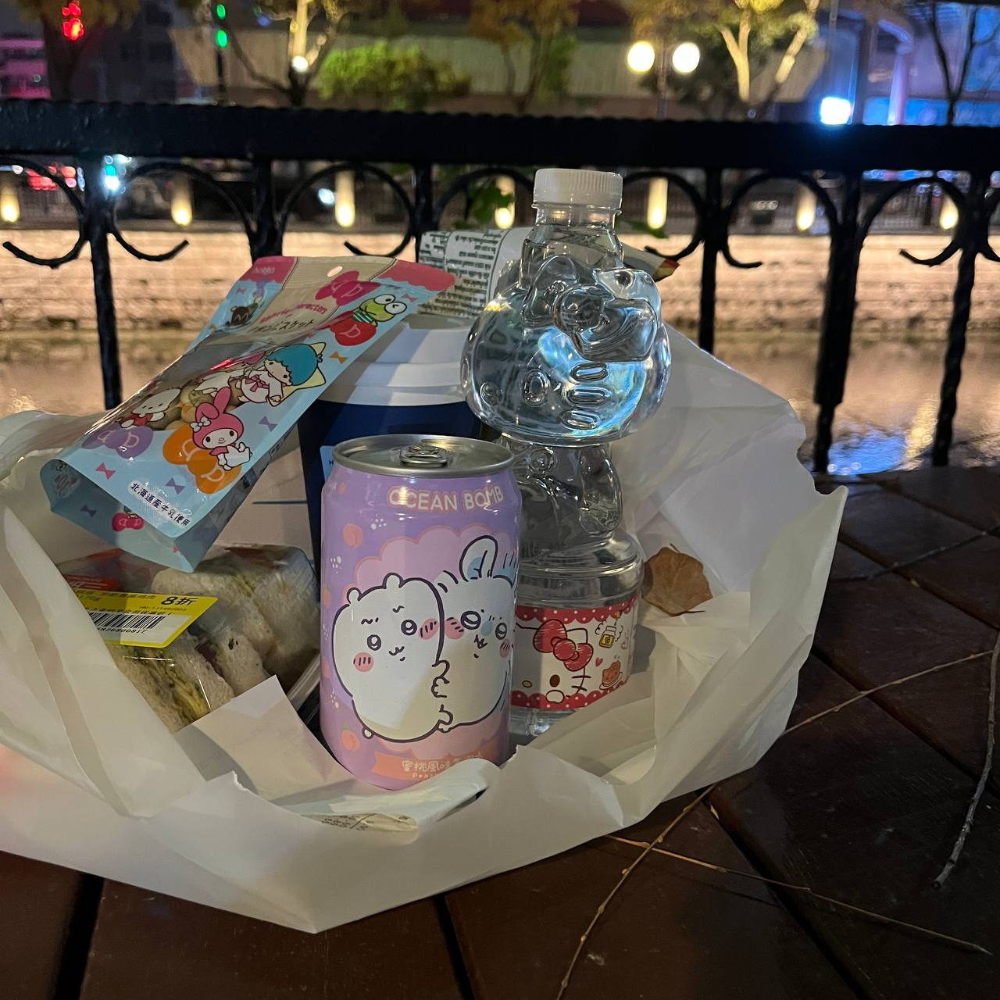
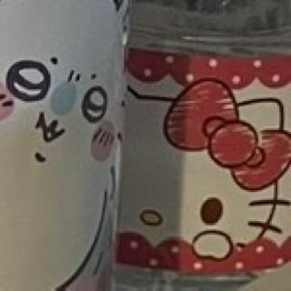
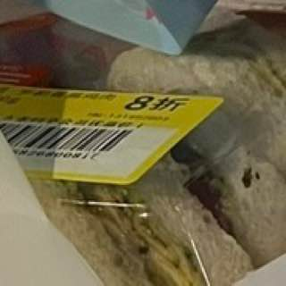
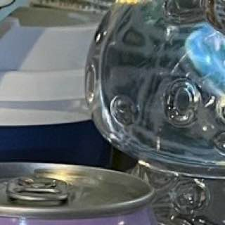
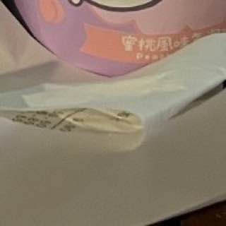



<figure class="wp-block-image size-large"></figure>

he1l0.kt7y 监控协议已启动。

检测到用户同意，系统正在继续执行。 

<figure class="wp-block-image size-large is-resized"></figure>

&gt; human activity detected.  

&gt; status: compromised.  

&gt; oh no. we’re doomed.

<figure class="wp-block-image size-large is-resized"></figure>

<figure class="wp-block-image size-large is-resized"></figure>

<figure class="wp-block-image size-large is-resized"></figure>

<figure class="wp-block-image size-large is-resized"></figure>

[系统提示]：她已经看到我们吃了第七块饼干。


