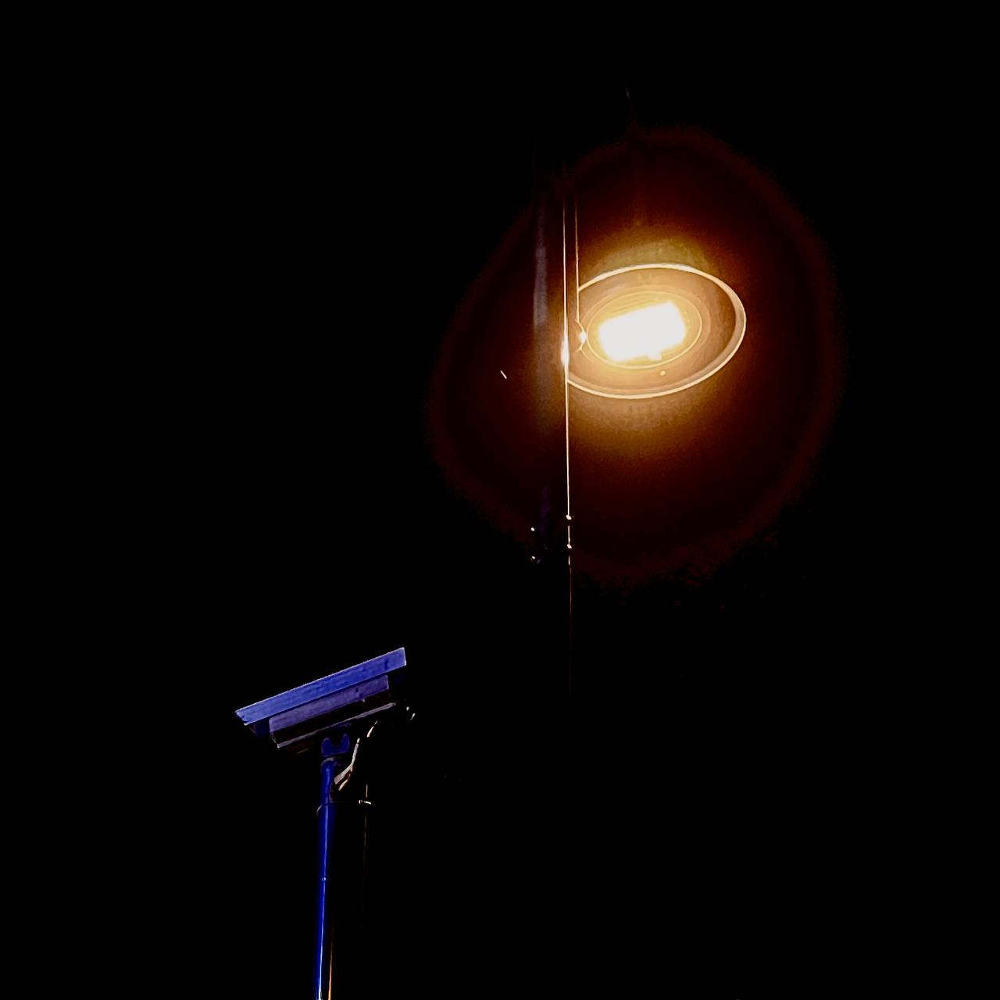



<figure class="wp-block-image size-large is-resized"></figure>

还有一道视线。

<figure class="wp-block-image size-large is-resized"><video controls="" playsinline="" preload="metadata" src="/posts/2025/04/posts-20250409-streetlight-001/assets/20250408streetlight.mp4" style="width:560px;height:auto"/></figure>
<figure class="wp-block-embed is-type-video is-provider-youtube wp-block-embed-youtube wp-embed-aspect-9-16 wp-has-aspect-ratio">

<iframe allow="accelerometer; autoplay; clipboard-write; encrypted-media; gyroscope; picture-in-picture; web-share" allowfullscreen="" frameborder="0" height="750" loading="lazy" referrerpolicy="strict-origin-when-cross-origin" src="https://www.youtube.com/embed/Z9XxnUCbfkc?feature=oembed" title="20250408streetlight" width="422"></iframe>

</figure>


